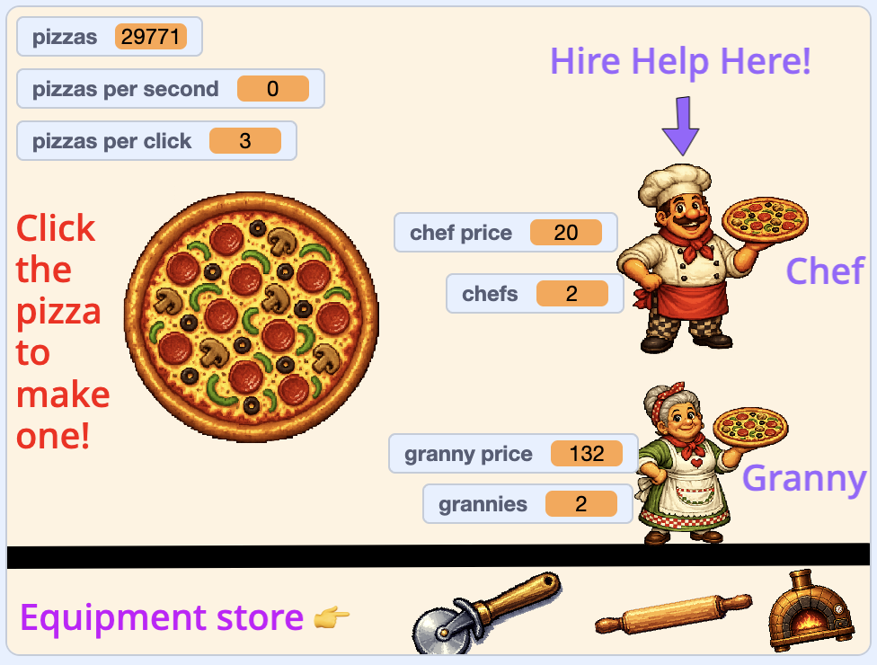

## Ce que tu vas faire

Crée un jeu de clic sans fin où les joueurs cliquent un élément, achètent des améliorations et regardent les chiffres augmenter de plus en plus vite.

> [!NOPRINT]
>
> 

>  <iframe allowtransparency="true" width="485" height="402" src="https://scratch.mit.edu/projects/embed/1361881665/?autostart=false" frameborder="0"></iframe>
> 

> [!PRINTONLY]
>
> 

Joue à la démo, puis crée ta propre version !

### Tu auras besoin :

- L'éditeur Scratch
- Un nouveau projet Scratch
