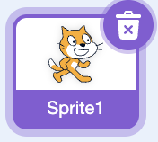
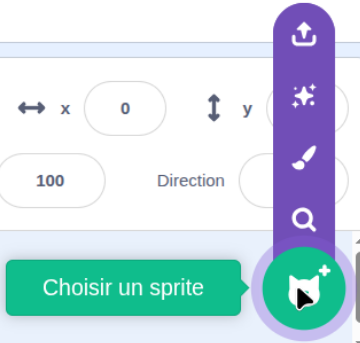
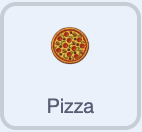
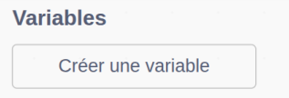
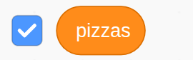
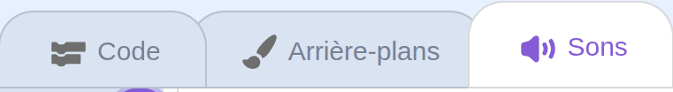
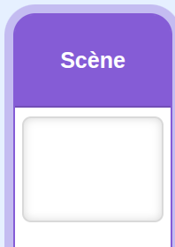

## Faire le clic

Ajoute un élément sur lequel cliquer et un score qui augmente lorsqu'on clique dessus.

> [!TASK]
>
> Ouvre un [nouveau projet Scratch](https://scratch.mit.edu/projects/editor/){:target="_blank"} dans un nouvel onglet.

> [!TASK]
>
> Supprime le sprite chat à l'aide du symbole de la corbeille.
>
> 

> [!TASK]
>
> Ajoute ton propre sprite avec **Choisir un sprite** (bibliothèque, **Télécharger**, ou **Peindre**).
>
> 
>
> Choisis un élément clair sur lequel les joueurs peuvent cliquer de nombreuses fois, comme de la nourriture, un trésor, une mascotte, un ballon ou quelque chose que tu dessines toi-même. Le projet de démonstration utilise une pizza.
>
> Utilise ton propre sprite, ou enregistre [le sprite pizza](images/pizza-sprite.png) et importe-le avec **Télécharger**.
>
> 

> [!TASK]
>
> Crée une variable de score et donne-lui un nom de pluriel sensé, comme `pizzas`, `pièces`, `buts`, ou `étoiles`. Coche la case pour que le joueur puisse voir son score.
>
> Les blocs de démonstration utilisent `pizzas`{:class="block3variables"}. Si tu choisis un autre nom, utilise ta variable partout où tu vois `pizzas`{:class="block3variables"}.
>
> 
>
> 

> [!TASK]
>
> Rends ton sprite cliquable, afin que chaque clic augmente ton score.
>
> <p align="center"></p>
>
> ```blocks3
> when this sprite clicked
> change [pizzas v] by (1)
> ```

Clique sur ton sprite. La variable de ton score augmente.

> [!TASK]
>
> Ajoute un son pour qu'un clic soit amusant. Ouvre l'onglet **Sons**, clique sur l'icône du haut-parleur et choisis un son court.
>
> 
>
> Ajoute-le en haut de ton script. Utilise `jouer le son`{:class="block3sound"} dans ce projet, pas `jouer le son jusqu'au bout`{:class="block3sound"}, ainsi le son commence sans tenir le reste du programme.
>
> ```blocks3
> when this sprite clicked
> +start sound (Tennis Hit v)
> change [pizzas v] by (1)
> ```

> [!TIP]
>
> Un code qui lance une action et la poursuit est appelé **non bloquant** car il n'interrompt pas le reste du programme.

> [!TASK]
>
> Fais rebondir le sprite en modifiant sa taille lorsqu'on clique dessus.
>
> <p align="center"></p>
>
> ```blocks3
> when this sprite clicked
> start sound (Tennis Hit v)
> change [pizzas v] by (1)
> +change size by (10)
> +wait (0.05) seconds
> +change size by (-10)
> ```

> [!TIP]
>
> **Le retour visuel** indique au joueur qu'une action a fonctionné. Le rebond rend chaque clic réel, avant même que le joueur ne consulte le score.

> [!TASK]
>
> Démarre un nouveau script. Sur le drapeau vert, définis le sprite comme `non glissable`{:class="block3sensing"} afin que le joueur clique dessus au lieu de le déplacer accidentellement sur la scène.
>
> <p align="center"></p>
>
> ```blocks3
> when green flag clicked
> set drag mode [not draggable v]
> ```

> [!TASK]
>
> Ajoute le son `Win`{:class="block3sound"} à ton sprite de clic.

> [!TASK]
>
> Ajoute la **condition de victoire** au même script. Il attend que le score soit suffisamment élevé, puis il célèbre.
>
> ```blocks3
> quand le drapeau vert est cliqué
> mettre mode de glissement à [non glissable v]
> +attendre jusqu'à ce que <(pizzas) > (10000)>
> +jouer le son (Victoire v)
> +dire [Tu as gagné !] pendant (2) secondes
> +stop [tout v]
> ```

> [!TIP]
>
> Une **condition de victoire** est la règle qui détermine quand un joueur a terminé ou gagné une partie.

> [!TASK]
>
> Clique sur `Scène`{:class="block3looks"} et réinitialise le score sur le drapeau vert.
>
> 
>
> ```blocks3
> when green flag clicked
> set [pizzas v] to (0)
> ```

> [!TASK]
>
> **Test :** clique sur le drapeau vert. Ton score devrait commencer à 0 et augmenter à chaque clic.
