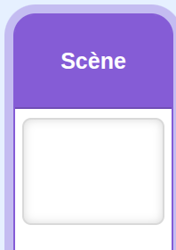
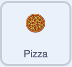
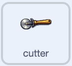
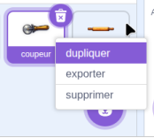
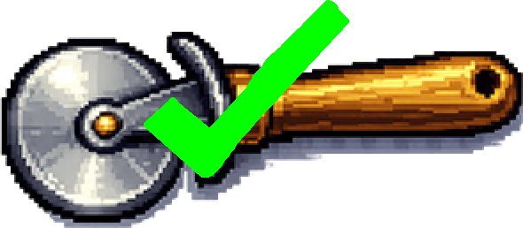

## Ajouter le premier équipement

Ajoute des équipements que le joueur peut débloquer pour que chaque clic ait plus de valeur.

> [!TASK]
>
> Crée une variable appelée `pizzas par clic`{:class="block3variables"}. Voici l'impact d'un seul clic sur le score du projet de démonstration.
>
> Si ta variable de score n'est pas `pizzas`{:class="block3variables"}, donne à cette variable un nom correspondant, comme `coins par clic` ou `buts par clic`.

> [!TIP]
>
> Toutes les informations changeant dont un jeu se souvient, comme les scores, les prix et les mises à niveau, sont appelées **l'état du jeu**.

> [!TASK]
>
> Clique sur la `Scene`{:class="block3looks"} et définit `pizzas par clic`{:class="block3variables"} à `1` sur le drapeau vert, donc un clic ajoute toujours au moins un.
>
> 
>
> ```blocks3
> when green flag clicked
> set [pizzas v] to (0)
> +set [pizzas per click v] to (1)
> ```

> [!TASK]
>
> Sur ton sprite principal de clic, fais en sorte que chaque clic utilise la variable au lieu d'une valeur fixe `1`.
>
> <p align="center"></p>
>
> ```blocks3
> when this sprite clicked
> start sound (Tennis Hit v)
> +change [pizzas v] by (pizzas per click)
> change size by (10)
> wait (0.05) seconds
> change size by (-10)
> ```

Rien ne change encore, parce que `pizzas par clic`{:class="block3variables"} est toujours `1`. L'équipement va l'améliorer.

> [!TASK]
>
> Ajoute ton premier équipement en tant que nouveau sprite. Choisis quelque chose qui semble améliorer chaque clic, comme un outil, une machine, une mise sous tension ou un badge. Le projet de démonstration utilise un coupeur.
>
> Utilise ton propre équipement, ou enregistre [le sprite de coupe] (images/cutter-sprite.png) et importe-le avec **Télécharger**.
>
> 

> [!TASK]
>
> Sélectionne le sprite de l'équipement et utilise la case **Taille** située sous la scène pour l'ajuster. Le coupeur du projet de démo est de `30`% de taille.
>
> Fais-le glisser vers le bas de la scène, en laissant de la place pour deux autres sprites d'équipement à côté.

> [!TASK]
>
> Dans l'onglet **Costumes**, clique avec le bouton droit sur le costume de l'équipement et choisis **dupliquer**. Garde d'abord le costume simple et le costume copié.
>
> 

> [!TASK]
>
> Change le deuxième costume pour qu'il montre clairement que l'équipement a été acheté. Le projet de démonstration affiche une coche verte.
>
> 

> [!TASK]
>
> Ajoute le son `Alert`{:class="block3sound"} à ton sprite d'équipement.

> [!TASK]
>
> Place l'équipement sur le drapeau vert : rends-le non déplaçable, passe au costume simple et cache-le.
>
> <p align="center"></p>
>
> ```blocks3
> when green flag clicked
> set drag mode [not draggable v]
> switch costume to (cutter v)
> hide
> ```

> [!TASK]
>
> Fais apparaître l'équipement uniquement lorsque le joueur peut se le permettre. Le son et la bulle de dialogue indiquent au joueur ce qui vient d'apparaître.
>
> Le coupeur coûte `25` de la variable de score, il apparaît donc lorsque le joueur a plus de `24`. Utiliser des chiffres plus élevés pour rendre les équipements ultérieurs plus chers.
>
> ```blocks3
> when green flag clicked
> set drag mode [not draggable v]
> switch costume to (cutter v)
> hide
> +wait until <(pizzas) > (24)>
> +show
> +start sound (Alert v)
> +say [New equipment unlocked!] for (2) seconds
> ```

> [!TIP]
>
> Une **condition de déblocage** est une règle qui rend un élément disponible uniquement après que le joueur ou la joueuse ait accompli suffisamment d'actions.

> [!TASK]
>
> Ajoute le son `Tada`{:class="block3sound"} à ton sprite d'équipement.

> [!TASK]
>
> Rends-le achetable. Vérifie que le coupeur porte toujours son premier costume et que le joueur a au moins `25` pizzas. Soustrais son prix, mets les clics du joueur à jour, puis passe au costume "acheté". Le costume garde en mémoire qu'il a été acheté, donc les clics suivants seront sans effet.
>
> <p align="center"></p>
>
> ```blocks3
> when this sprite clicked
> if <<(costume [number v]) = (1)> and <(pizzas) > (24)>> then
> start sound (Tada v)
> change [pizzas v] by (-25)
> set [pizzas per click v] to (2)
> next costume
> end
> ```

Clique jusqu'à ce que le score atteigne 25. Achete le coupeur et vérifie que le score diminue de 25, la coche verte apparaît et chaque clic vaut désormais 2. Cliquez à nouveau sur le coupeur: le score et le costume doivent rester les mêmes. Redémarre le jeu et vérifie que tu peux l'acheter à nouveau.

> [!TIP]
>
> Les développeur·euses de jeux conçoivent et testent souvent d'abord un **prototype** fonctionnel. Réparer le coupeur avant de copier ses scripts rend les problèmes plus faciles à trouver.
