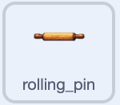
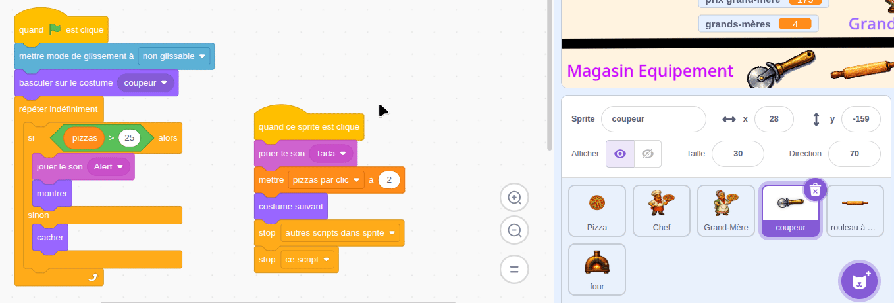
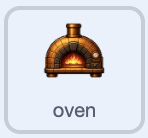
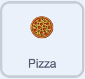

## Ajouter plus d'équipement

Développe le prototype du coupeur avec deux améliorations supplémentaires qui rendent chaque clic encore plus rentable.

> [!TASK]
>
> Ajoute un rouleau à pâtisserie comme nouveau sprite.
>
> 
>
> Utilise ton propre équipement, ou enregistre [le sprite du rouleau à pâtisserie](images/rolling-pin-sprite.png) et importe-le avec **Télécharger**.

> [!TASK]
>
> Utilise la case **Taille** située sous la Scène pour redimensionner le rouleau à pâtisserie, puis fais-le glisser à côté du coupeur. Le rouleau à pâtisserie du projet de démonstration à `30`% de sa taille initiale.

> [!TASK]
>
> Ouvre l'onglet **Costumes** du rouleau à pâtisserie. Fais un clic droit sur son costume et choisis **dupliquer**, en gardant le costume simple en premier et le costume copié en second.
>
> Ajoute une coche verte au deuxième costume pour que le joueur puisse voir quand le rouleau à pâtisserie a été acheté.

> [!TASK]
>
> Copie les deux scripts du coupeur sur le rouleau à pâtisserie en faisant glisser chaque script sur le rouleau à pâtisserie dans la liste des sprites. Ajoute également les sons `Alert`{:class="block3sound"} et `Tada`{:class="block3sound"}.
>
> > [!NOPRINT]
> >
> > 

> [!TASK]
>
> Mets à jour les scripts copiés pour le rouleau à pâtisserie. Cela coûte `500` et mets `pizzas par clic`{:class="block3variables"} à `6`.
>
> <p align="center"></p>
>
> ```blocks3
> when green flag clicked
> set drag mode [not draggable v]
> switch costume to (rolling_pin v)
> hide
> wait until <(pizzas) > (499)>
> show
> start sound (Alert v)
> say [New equipment unlocked!] for (2) seconds
> ```
>
> ```blocks3
> when this sprite clicked
> if <<(costume [number v]) = (1)> and <(pizzas) > (499)>> then
> start sound (Tada v)
> change [pizzas v] by (-500)
> set [pizzas per click v] to (6)
> next costume
> end
> ```

Clique jusqu'à ce que le score atteigne 500. Le rouleau à pâtisserie apparaît ; clique dessus pour l’acheter et vérifie que son costume coche verte apparaît.

> [!TASK]
>
> Ajoute un four comme nouveau sprite.
>
> 
>
> Utilise ton propre équipement, ou enregistre [le sprite du four](images/oven-sprite.png) et importe-le avec **Télécharger**.

> [!TASK]
>
> Redimensionne le four et fais-le glisser à côté des autres équipements. Le four du projet de démonstration à `17`% de sa taille initiale.

> [!TASK]
>
> Ouvre l'onglet **Costumes** du four. Fais un clic droit sur son costume et choisis **dupliquer**, en gardant le costume simple en premier et le costume copié en second.
>
> Ajoute une coche verte au deuxième costume pour que le joueur puisse voir quand le four a été acheté.

> [!TASK]
>
> Copie les deux scripts du rouleau à pâtisserie sur le four en faisant glisser chaque script sur le four dans la liste des sprites. Ajoute également les sons `Alert`{:class="block3sound"} et `Tada`{:class="block3sound"}.

> [!TASK]
>
> Mets à jour les scripts copiés pour le four. Cela coûte `3000` et mets `pizzas par clic`{:class="block3variables"} à `24`.
>
> <p align="center"></p>
>
> ```blocks3
> when green flag clicked
> set drag mode [not draggable v]
> switch costume to (oven v)
> hide
> wait until <(pizzas) > (2999)>
> show
> start sound (Alert v)
> say [New equipment unlocked!] for (2) seconds
> ```
>
> ```blocks3
> when this sprite clicked
> if <<(costume [number v]) = (1)> and <(pizzas) > (2999)>> then
> start sound (Tada v)
> change [pizzas v] by (-3000)
> set [pizzas per click v] to (24)
> next costume
> end
> ```

Clique jusqu'à ce que le score atteigne 3000. Achete le four et vérifie que son costume à coche verte apparaît ; chaque clic vaut 24. Plus tard, les assistants pourront également gagner la dernière pizza nécessaire pour débloquer l'équipement ; la bulle de dialogue indique clairement la signification de l'alerte.

> [!TASK]
>
> Pour gagner, il faut que le joueur obtienne toutes les améliorations. Sur ton sprite de clic principal, mets à jour le `attendre jusqu'à`{:class="block3control"} afin que le joueur ait besoin d'un score élevé **et** de tout l'équipement (ce qui définit `pizzas par clic`{:class="block3variables"} à `24` dans le projet de démonstration).
>
> <p align="center"></p>
>
> ```blocks3
> when green flag clicked
> set drag mode [not draggable v]
> +wait until <<(pizzas) > (10000)> and <(pizzas per click) = (24)>>
> start sound (Win v)
> say [You Win!] for (2) seconds
> stop [all v]
> ```

Achète les trois équipements. Le message de victoire n'apparaît désormais que lorsque le projet de démonstration est entièrement équipé.
