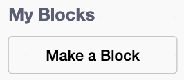

## Ajouter des clics automatiques

Ajoute une aide qui fait des pizzas chaque seconde, même lorsque le joueur arrête de cliquer. Le joueur peut engager le même type d'aide plus d'une fois, et chacun ajoute une autre pizza par seconde.

> [!TASK]
>
> Ajoute un sprite d'aide. Choisis un personnage ou une machine qui semble pouvoir fonctionner automatiquement. Le projet de démonstration utilise un chef cuisinier.
>
> 
>
> Utilise votre ton assistant, ou enregistre [le sprite chef] (images/chef-sprite.png) et importe-le avec **Télécharger**.

> [!TASK]
>
> Sélectionne l'aide et utilise la case **Taille** au-dessous de la scène pour la rendre adaptée. Le chef du projet de démonstration a une taille de 30\`%.
>
> Glisse-le dans une partie vide de la scène où il ne couvrira pas le score ou l'équipement. Le projet de démonstration met le chef sur la droite.

> [!TASK]
>
> Ajoute le son `Clang`{:class="block3sound"} au sprite d'aide.

> [!TASK]
>
> Crée une variable appelée `chefs`{:class="block3variables"}. Cela enregistre le nombre de chefs engagés par le joueur.

> [!TASK]
>
> Crée une variable appelée `chef prix`{:class="block3variables"}. Elle stocke combien de pizzas le prochain chef coûte.

> [!TASK]
>
> Crée une variable appelée `pizzas par seconde`{:class="block3variables"}. Cela indique combien de pizzas tous les aides préparent chaque seconde.

> [!TASK]
>
> Clique sur la `Scène`{:class="block3looks"} et donne des valeurs de départ aux variables d'aide sur le drapeau vert.
>
> Le premier assistant coûte `50`, donc le coupeur se débloque toujours en premier à `25`.
>
> 
>
> ```blocks3
> when green flag clicked
> set [pizzas v] to (0)
> set [pizzas per click v] to (1)
> +set [chefs v] to (0)
> +set [chef price v] to (50)
> +set [pizzas per second v] to (0)
> ```

Clique sur le drapeau vert. Les nouveaux affichages devraient indiquer `chefs 0`, `chef prix 50` et `pizzas par second 0`.

> [!TASK]
>
> Sur le sprite d'aide, démarre son script d'achat. Cliquer sur l'aide dépense son prix actuel et embauche un aide.
>
> Le bloc `mettre`{:class="block3variables"} a besoin d'un nombre négatif pour dépenser des pizzas. `0 - chef prix` transforme le prix en ce nombre négatif.
>
> <p align="center"></p>
>
> ```blocks3
> when this sprite clicked
> start sound (Clang v)
> change [pizzas v] by ((0) - (chef price))
> change [chefs v] by (1)
> ```

> [!TASK]
>
> Ajoute un bloc pour que le prochain aide coûte environ 15% de plus.
>
> Multiplier par `1,15` ajoute 15 % à l'ancien prix. `arrondi`{:class="block3operators"} conserve le nouveau prix sous forme de nombre entier.
>
> ```blocks3
> lorsque ce sprite a cliqué
> démarrer le son (Clang v)
> ajouter((0) - (prix du chef)) à [pizzas v] 
> ajouter 1 à [chefs v] 
> +mettre [prix du chef v] à (arrondir ((prix du chef) * (1,15)))
> ```

La première aide coûte 50 pizzas. Après l'avoir acheté, `chefs` devrait être `1` et `chef prix` devrait être `58`.

> [!TIP]
>
> Une **courbe de progression** contrôle à quelle vitesse un jeu devient plus difficile, plus rapide ou plus coûteux au fur et à mesure que le joueur s'améliore.

> [!TASK]
>
> Faire apparaître l'aide uniquement lorsque le joueur peut se permettre le prix actuel.
>
> Scratch has no `greater than or equal to` block. Because the score uses whole numbers, checking for `pizzas > chef price - 1` does the same thing.
>
> <p align="center"></p>
>
> ```blocks3
> when green flag clicked
> set drag mode [not draggable v]
> hide
> forever
> if <(pizzas) > ((chef price) - (1))> then
> show
> else
> hide
> end
> end
> ```

Click the green flag and click the main sprite. The helper should stay hidden up to 49 pizzas and appear when the score reaches 50.

> [!TASK]
>
> Click the `Stage`{:class="block3looks"}. In `My Blocks`{:class="block3custom"}, click **Make a Block**, name it `update pizzas per second`{:class="block3custom"}, and build its definition.
>
> Each chef makes one pizza per second, so the rate is the same as the number stored in `chefs`{:class="block3variables"}.
>
> 
>
> 
>
> ```blocks3
> define update pizzas per second
> set [pizzas per second v] to (chefs)
> ```

> [!TIP]
>
> In many programming languages, a reusable block of code like this is called a **function**.

> [!TASK]
>
> Still on the Stage, add a script that runs the new block whenever a helper asks for the rate to be updated.
>
> In the `when I receive`{:class="block3events"} block, open the message menu, choose **New message**, and name it `update`.
>
> ```blocks3
> when I receive (update v)
> update pizzas per second :: custom
> ```

> [!TASK]
>
> Return to the helper sprite. Broadcast `update` at the end of its buy script so the Stage recalculates the rate after every purchase.
>
> ```blocks3
> when this sprite clicked
> start sound (Clang v)
> change [pizzas v] by ((0) - (chef price))
> change [chefs v] by (1)
> set [chef price v] to (round ((chef price) * (1.15)))
> +broadcast (update v)
> ```

> [!TASK]
>
> On the Stage, finish the green flag script with the game's clock. Every second, it adds the current `pizzas per second`{:class="block3variables"} rate to the score.
>
> ```blocks3
> when green flag clicked
> set [pizzas v] to (0)
> set [pizzas per click v] to (1)
> set [chefs v] to (0)
> set [chef price v] to (50)
> update pizzas per second :: custom
> forever
> wait (1) seconds
> change [pizzas v] by (pizzas per second)
> end
> ```

> [!TIP]
>
> A regular moment when a game updates its numbers is called a **tick**. This clicker has one tick every second.

Click the green flag, earn 50 pizzas, and buy one helper. Check that `chefs` becomes `1` and `pizzas per second` becomes `1`, then stop clicking. The score should rise by one every second.

The helper is a repeatable upgrade. When the score reaches its new price, the same sprite appears again so the player can hire another one.
