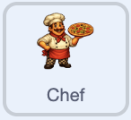
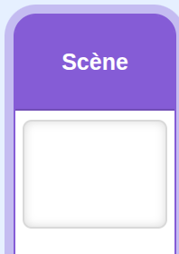

## Ajouter des clics automatiques

Ajoute un assistant qui fait des pizzas chaque seconde, même lorsque le joueur arrête de cliquer. Le joueur peut engager le même type d'assitant plus d'une fois, et chacun ajoute une autre pizza par seconde.

> [!TASK]
>
> Ajoute un sprite d'assistant. Choisis un personnage ou une machine qui semble pouvoir fonctionner automatiquement. Le projet de démonstration utilise un chef cuisinier.
>
> 
>
> Utilise ton assistant, ou enregistre [le sprite chef] (images/chef-sprite.png) et importe-le avec **Télécharger**.

> [!TASK]
>
> Sélectionne l'assistant et utilise la case **Taille** au-dessous de la scène pour l'ajuster. Le chef du projet de démonstration est de `30`% de sa taille initiale.
>
> Glisse-le dans une partie vide de la scène où il ne couvrira pas le score ou l'équipement. Le projet de démonstration met le chef sur la droite.

> [!TASK]
>
> Ajoute le son `Clang`{:class="block3sound"} au sprite d'assistant.

> [!TASK]
>
> Crée une variable appelée `chefs`{:class="block3variables"}. Cela enregistre le nombre de chefs recrutés par le joueur.

> [!TASK]
>
> Crée une variable appelée `prix chef`{:class="block3variables"}. Elle stocke combien de pizzas le prochain chef coûte.

> [!TASK]
>
> Crée une variable appelée `pizzas par seconde`{:class="block3variables"}. Cela indique combien de pizzas tous les assistants préparent chaque seconde.

> [!TASK]
>
> Clique sur la `Scène`{:class="block3looks"} et donne des valeurs de départ aux variables d'assistant sur le drapeau vert.
>
> Le premier assistant coûte `50`, donc le coupeur se débloque toujours en premier à `25`.
>
> 
>
> ```blocks3
> when green flag clicked
> set [pizzas v] to (0)
> set [pizzas per click v] to (1)
> +set [chefs v] to (0)
> +set [chef price v] to (50)
> +set [pizzas per second v] to (0)
> ```

Clique sur le drapeau vert. Les nouveaux affichages devraient indiquer `chefs 0`, `prix chef 50` et `pizzas par second 0`.

> [!TASK]
>
> Sur le sprite d'assistant, démarre son script d'achat. Cliquer sur l'assistant dépense son prix actuel et recrute un assistant.
>
> Le bloc `mettre`{:class="block3variables"} a besoin d'un nombre négatif pour dépenser des pizzas. `0 - prix chef` transforme le prix en ce nombre négatif.
>
> <p align="center"></p>
>
> ```blocks3
> when this sprite clicked
> start sound (Clang v)
> change [pizzas v] by ((0) - (chef price))
> change [chefs v] by (1)
> ```

> [!TASK]
>
> Ajoute un bloc pour que le prochain assistant coûte environ 15% de plus.
>
> Multiplier par `1,15` ajoute 15 % à l'ancien prix. `arrondi`{:class="block3operators"} conserve le nouveau prix sous forme de nombre entier.
>
> ```blocks3
> quand ce sprite est cliqué
> jouer le son (Clang v)
> ajouter((0) - (prix chef)) à [pizzas v] 
> ajouter 1 à [chefs v] 
> +mettre [prix chef v] à (arrondir ((prix chef) * (1,15)))
> ```

Le premier assistant coûte 50 pizzas. Après l'avoir acheté, `chefs` devrait être `1` et `prix chef` devrait être `58`.

> [!TIP]
>
> Une **courbe de progression** contrôle à quelle vitesse un jeu devient plus difficile, plus rapide ou plus coûteux au fur et à mesure que le joueur s'améliore.

> [!TASK]
>
> Faire apparaître l'assistant uniquement lorsque le joueur peut se permettre le prix actuel.
>
> Scratch n'a pas de bloc `supérieur ou égal à`. Parce que le score utilise des nombres entiers, vérifie que `pizzas > prix chef - 1` fait la même chose.
>
> <p align="center"></p>
>
> ```blocks3
> when green flag clicked
> set drag mode [not draggable v]
> hide
> forever
> if <(pizzas) > ((chef price) - (1))> then
> show
> else
> hide
> end
> end
> ```

Clique sur le drapeau vert et clique sur le sprite principal. L'assistant devrait rester caché jusqu'à 49 pizzas et apparaître lorsque le score atteint 50.

> [!TASK]
>
> Clique sur la `Scène`{:class="block3looks"}. Dans `Mes blocs`{:class="block3custom"}, clique sur **Créer un bloc**, nomme-le `mettre à jour les pizzas par seconde`{:class="block3custom"}, et crée sa définition.
>
> Chaque chef fait une pizza par seconde, donc le prix est le même que le nombre stocké dans `chefs`{:class="block3variables"}.
>
> 
>
> 
>
> ```blocks3
> define update pizzas per second
> set [pizzas per second v] to (chefs)
> ```

> [!TIP]
>
> Dans de nombreux langages de programmation, un bloc de code réutilisable comme celui-ci est appelé une **fonction**.

> [!TASK]
>
> Toujours sur la scène, ajoute un script qui exécute le nouveau bloc chaque fois qu'un assistant demande que le prix soit mis à jour.
>
> Dans le bloc `quand je reçois`{:class="block3events"}, ouvre le menu des messages, choisis **Nouveau message**, et nomme-le `mise à jour`.
>
> ```blocks3
> when I receive (update v)
> update pizzas per second :: custom
> ```

> [!TASK]
>
> Retourne au sprite d'assistant. Envoie `mise à jour` à la fin de son script d'achat afin que l'étape recalcule le prix après chaque achat.
>
> ```blocks3
> when this sprite clicked
> start sound (Clang v)
> change [pizzas v] by ((0) - (chef price))
> change [chefs v] by (1)
> set [chef price v] to (round ((chef price) * (1.15)))
> +broadcast (update v)
> ```

> [!TASK]
>
> Sur la scène, termine le script du drapeau vert avec l'horloge du jeu. Chaque seconde, il ajoute le prix actuel de `pizzas par seconde`{:class="block3variables"} au score.
>
> ```blocks3
> when green flag clicked
> set [pizzas v] to (0)
> set [pizzas per click v] to (1)
> set [chefs v] to (0)
> set [chef price v] to (50)
> update pizzas per second :: custom
> forever
> wait (1) seconds
> change [pizzas v] by (pizzas per second)
> end
> ```

> [!TIP]
>
> Un moment régulier où un jeu met à jour ses numéros est appelé **tic**. Ce clicker émet un tic par seconde.

Clique sur le drapeau vert, gagne 50 pizzas et achète un assistant. Vérifie que `chefs` devient `1` et que `pizzas par seconde` devient `1`, puis arrête de cliquer. Le score devrait augmenter d'un point chaque seconde.

L'assistant est une amélioration répétable. Quand le score atteint son nouveau prix, le même sprite apparaît à nouveau pour que le joueur puisse en recruter un autre.
