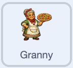
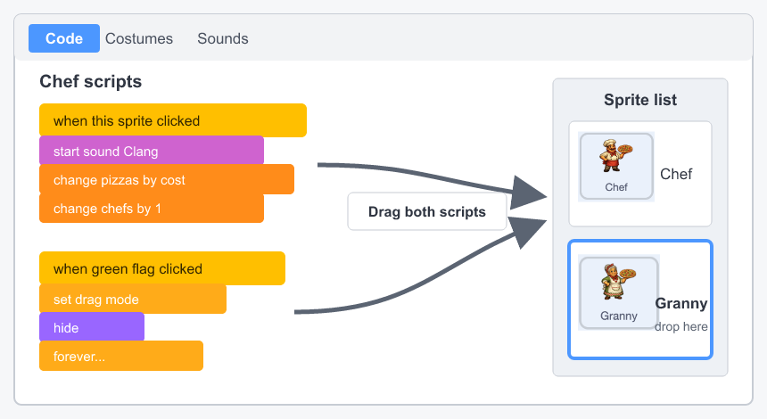
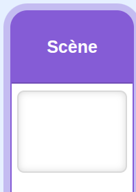

## Ajouter un deuxième clic automatique

Ajoute un second assistant plus performant qui fait cinq pizzas par seconde au lieu d'une seule.

> [!TASK]
>
> Ajoute un autre sprite d'assistant. Le projet de démonstration utilise une grand-mère.
>
> 
>
> Utilise ton propre assistant, ou enregistre [le sprite de la grand-mère](images/granny-sprite.png) et importe-le avec **Télécharger**.

> [!TASK]
>
> Utilise la case **Taille** sous la scène pour redimensionner le deuxième assistant, puis déplace-le par glisser-déposer afin de le positionner correctement. Dans le projet de démonstration, la grand-mère mesure `30`% de sa taille initiale et se trouve en dessous du chef, à droite.

> [!TASK]
>
> Copie les deux scripts de ton premier assistant sur le nouveau sprite : fais glisser chaque script depuis la zone de code et dépose-le sur le nouveau sprite dans la liste des sprites.
>
> > [!NOPRINT]
> >
> > 

> [!TASK]
>
> Crée une variable appelée `grands-mères`{:class="block3variables"} pour indiquer combien de seconds assistants le joueur a recruté.

> [!TASK]
>
> Crée une variable appelée `prix grand-mère`{:class="block3variables"} pour indiquer le prix de la prochaine pizza.

> [!TASK]
>
> Ajoute le son `Collect`{:class="block3sound"} au second sprite d'assistant.

> [!TASK]
>
> Clique sur la `Scène`{:class="block3looks"} et ajoute des valeurs de départ pour les nouvelles variables. Le deuxième assistant commence à `100` pizzas parce qu'il travaille cinq fois plus vite.
>
> 
>
> ```blocks3
> when green flag clicked
> set [pizzas v] to (0)
> set [pizzas per click v] to (1)
> set [chefs v] to (0)
> set [chef price v] to (50)
> +set [grannies v] to (0)
> +set [granny price v] to (100)
> update pizzas per second :: custom
> forever
> wait (1) seconds
> change [pizzas v] by (pizzas per second)
> end
> ```

Clique sur le drapeau vert. Les nouveaux affichages devraient indiquer `grands-mères 0` et `prix grand-mère 100`.

> [!TASK]
>
> Sur le deuxième assistant, mets à jour le script d'achat copié pour utiliser son son, son nombre et son prix.
>
> Le `envoyer à tous`{:class="block3events"} reste à la fin parce que l'achat de l'un ou l'autre type d'assistant change le prix des pizzas par seconde.
>
> <p align="center"></p>
>
> ```blocks3
> when this sprite clicked
> start sound (Collect v)
> change [pizzas v] by ((0) - (granny price))
> change [grannies v] by (1)
> set [granny price v] to (round ((granny price) * (1.15)))
> broadcast (update v)
> ```

> [!TASK]
>
> Mets à jour le script de drapeau vert copié afin que le deuxième assistant n'apparaisse que lorsque son propre prix est abordable.
>
> <p align="center"></p>
>
> ```blocks3
> when green flag clicked
> set drag mode [not draggable v]
> hide
> forever
> if <(pizzas) > ((granny price) - (1))> then
> show
> else
> hide
> end
> end
> ```

Clique sur le drapeau vert et augmente le score. Le premier assistant devrait apparaître à 50 pizzas et le second assistant à 100 pizzas.

> [!TASK]
>
> Sur la `Scène`{:class="block3looks"}, mets à jour la définition `mettre à jour les pizzas par seconde`{:class="block3custom"}.
>
> Le nombre de chefs représente déjà leur contribution, car chacun prépare une pizza par seconde. Chaque grand-mère en fait cinq, donc multiplie seulement `grands-mères`{:class="block3variables"} par `5`.
>
> 
>
> ```blocks3
> define update pizzas per second
> set [pizzas per second v] to ((chefs) + ((grannies) * (5)))
> ```

> [!TIP]
>
> Choisir les coûts et les récompenses de manière à ce que chaque amélioration paraisse intéressante s'appelle l'**équilibrage du jeu**.

Achète un premier assistant et une grand-mère. `pizzas par seconde` devrait devenir `6` : une du premier assistant et cinq de la grand-mère. Arrête de cliquer et vérifie que le score augmente de six points chaque seconde.

Tu as maintenant d'un clicker infini complet : clics, équipements et assistants répétables fonctionnent tous ensemble.

> [!TIP]
>
> Cliquer, gagner, acheter des améliorations, puis gagner encore plus vite constituent le **cycle de jeu principal**.
