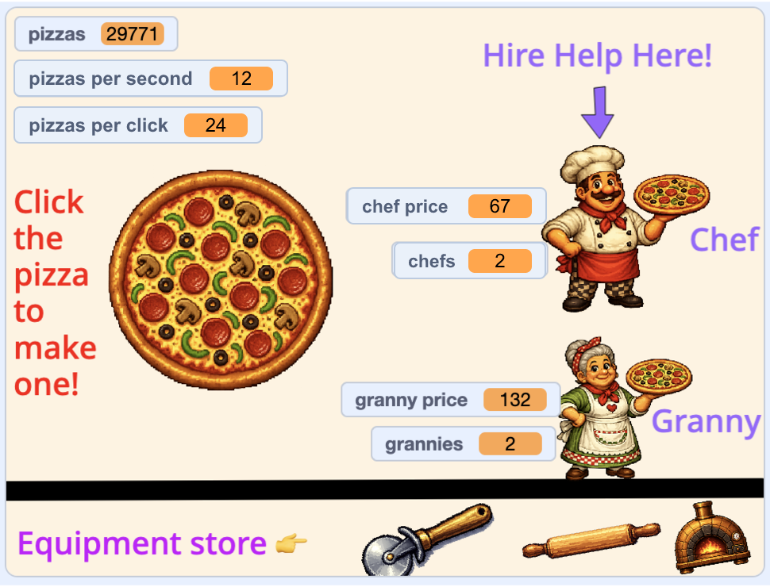

## Ajouter un arrière-plan

Le jeu fonctionne maintenant, mais il est assez basique. Donne-lui une façade digne de ce nom et soigne les affichages pour que le joueur comprenne ce que tout signifie.

> [!TASK]
>
> Peindre un nouvel arrière-plan. Passe ta souris sur **Choisir un arrière-plan** (en bas à droite) et clique sur **Peindre** pour en créer un vierge.

> [!TASK]
>
> Utilise l'outil **Texte** de l'éditeur de peinture pour ajouter des étiquettes et des instructions. La pizzeria utilise les options « Clique sur la pizza pour en commander une ! », « Embauche du personnel ici ! » et « Magasin de matériel ». Utilise tes propres mots et couleurs.

> [!TASK]
>
> Fais glisser tes sprites à l'endroit voulu sur la scène. La pizzeria place la pizza au milieu, le chef et la grand-mère à droite, et le matériel en bas.

> [!TASK]
>
> Fais glisser l'affichage de chaque variable à l'endroit souhaité. La pizzeria empile `pizzas`{:class="block3variables"}, `pizzas par seconde`{:class="block3variables"} et `pizzas par clic`{:class="block3variables"} en haut à gauche, place `prix chef`{:class="block3variables"} et `chefs`{:class="block3variables"} à côté du chef, et `prix grand-mère`{:class="block3variables"} et `grands-mères`{:class="block3variables"} à côté de la grand-mère.

> [!TIP]
>
> Le score, les prix et les autres informations affichées en haut d'un jeu sont souvent appelés **HUD**, abréviation de **heads-up** (tête haute).

Clique sur le drapeau vert et compare ta mise en page avec l'exemple. Vérifie que chaque sprite et variable est visible, que rien ne masque les instructions et que les sprites d'aide sont suffisamment petits pour tenir à droite. Ton jeu peut avoir l'apparence que tu souhaites.

