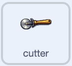

## Animer l'équipement

Fais bouger ton matériel pour que le magasin paraisse vivant.

> [!TASK]
>
> Ajoute ce script à ton premier équipement. Il oriente le sprite dans la direction « 90 » pour démarrer le niveau, puis le fait osciller d'avant en arrière indéfiniment.
>
> <p align="center"></p>
>
> ```blocks3
> when green flag clicked
> point in direction (90)
> forever
> turn right (10) degrees
> wait (0.2) seconds
> turn left (10) degrees
> wait (0.2) seconds
> turn left (10) degrees
> wait (0.2) seconds
> turn right (10) degrees
> wait (0.2) seconds
> end
> ```

> [!TASK]
>
> Ajoute le même script à tes autres sprites d'équipement en le faisant glisser sur chacun des sprites dans la liste des sprites.

Clique sur le drapeau vert. Chaque sprite d'équipement doit osciller doucement d'un côté à l'autre et revenir à sa direction de départ après chaque oscillation.
