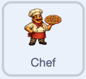

## Animate the auto-clickers

Give your helpers a gentle pulse so they look busy at work.

> [!TASK]
>
> Add this script to your first helper. It grows the sprite a little, then shrinks it back, over and over.
>
> <p align="center"></p>
>
> ```blocks3
> when green flag clicked
> forever
> repeat (5)
> change size by (2)
> wait (0.05) seconds
> end
> repeat (5)
> change size by (-2)
> wait (0.05) seconds
> end
> end
> ```

> [!TASK]
>
> Add the same script to your other helper by dragging it onto them in the sprite list.

Clique sur le drapeau vert. Each helper should grow by 10 in total, shrink by 10, and return to its starting size before the next pulse. Leave the game running and check that the helpers keep pulsing while the score still rises every second.

> [!TIP]
>
> Small animations that make a game feel lively without changing its rules are part of **game feel**, sometimes called **juice**.

> [!SAVE]
