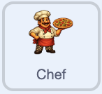

## Animer les clics automatiques

Donne à tes aides une légère impulsion pour qu'ils paraissent occupés au travail.

> [!TASK]
>
> Ajoute ce script à ton premier aide. Il agrandit un peu le sprite, puis le rétrécit, et ce, sans cesse.
>
> <p align="center"></p>
>
> ```blocks3
> when green flag clicked
> forever
> repeat (5)
> change size by (2)
> wait (0.05) seconds
> end
> repeat (5)
> change size by (-2)
> wait (0.05) seconds
> end
> end
> ```

> [!TASK]
>
> Ajoute le même script à ton autre aide en le faisant glisser sur lui dans la liste des sprites.

Clique sur le drapeau vert. Chaque aide devrait grandir de 10 au total, rétrécir de 10, puis revenir à sa taille initiale avant la prochaine impulsion. Laisse le jeu tourner et vérifie que les indicateurs continuent de clignoter pendant que le score augmente chaque seconde.

> [!TIP]
>
> Les petites animations qui rendent un jeu vivant sans modifier ses règles font partie de **sensation de jeu**, parfois appelé **juice** (jus).

> [!SAVE]
