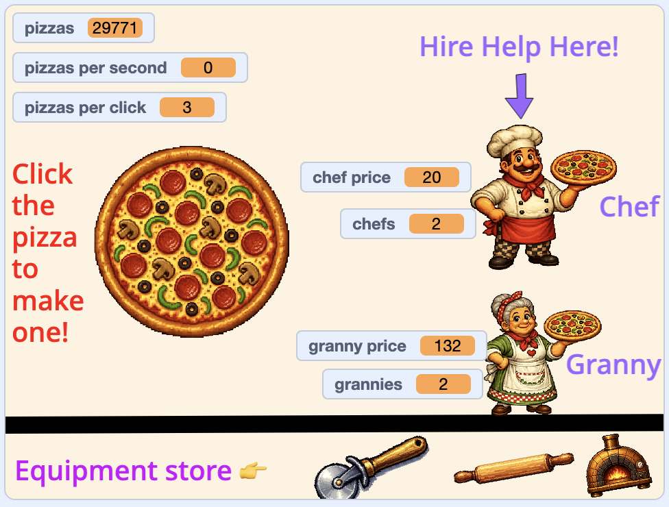

## Che cosa farai

Crea un clicker infinito in cui i giocatori toccano un elemento, acquistano potenziamenti e guardano i numeri crescere più velocemente.

> [!NOPRINT]
>
> 

>  <iframe allowtransparency="true" width="485" height="402" src="https://scratch.mit.edu/projects/embed/1361881665/?autostart=false" frameborder="0"></iframe>
> 

> [!PRINTONLY]
>
> 

Gioca alla demo, poi crea la tua versione!

### Ti serviranno:

- L'editor di Scratch
- Inizia un nuovo progetto Scratch
