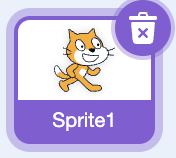
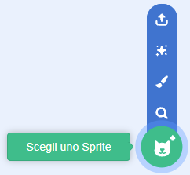
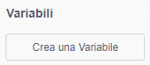
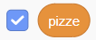
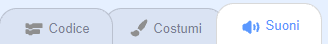
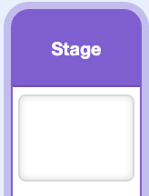

## Crea il clicker

Aggiungi un elemento su cui cliccare e un punteggio che aumenta a ogni clic.

> [!TASK]
>
> Apri un [nuovo progetto Scratch](https://scratch.mit.edu/projects/editor/){:target="_blank"} in una nuova scheda.

> [!TASK]
>
> Elimina lo sprite del gatto usando l'icona del cestino.
>
> 

> [!TASK]
>
> Aggiungi il tuo sprite con **Scegli uno Sprite** (Libreria, **Importa**, o **Disegna**).
>
> 
>
> Scegli un elemento ben definito su cui i giocatori possano cliccare più volte, come cibo, un tesoro, una mascotte, una palla o qualcosa che disegni tu stesso. Il progetto dimostrativo utilizza una pizza.
>
> Usa il tuo sprite, oppure salva [lo sprite della pizza](images/pizza-sprite.png) e importalo con **Importa**.
>
> 

> [!TASK]
>
> Crea una variabile di punteggio e assegnale un nome plurale appropriato, come ad esempio `pizze`, `monete`, `gol` o `stelle`. Seleziona questa casella affinché il giocatore possa visualizzare il proprio punteggio.
>
> I blocchi dimostrativi utilizzano `pizze`{:class="block3variables"}. Se scegli un altro nome, usa la tua variabile ovunque vedi `pizze`{:class="block3variables"}.
>
> 
>
> 

> [!TASK]
>
> Rendi il tuo sprite cliccabile, in modo che ogni clic aumenti il tuo punteggio.
>
> <p align="center"></p>
>
> ```blocks3
> when this sprite clicked
> change [pizzas v] by (1)
> ```

Fai clic sul tuo sprite. La tua variabile punteggio aumenta.

> [!TASK]
>
> Aggiungi un suono in modo che il clic sia divertente. Apri la scheda **Suoni**, fai clic sull'icona dell'altoparlante e scegli un suono breve.
>
> 
>
> Aggiungilo alla parte superiore del tuo script. In questo progetto, usa `avvia riproduzione suono`{:class="block3sound"} e non `riproduci suono e attendi la fine`{:class="block3sound"}, in modo che il suono inizi senza bloccare il resto del programma.
>
> ```blocks3
> when this sprite clicked
> +start sound (Tennis Hit v)
> change [pizzas v] by (1)
> ```

> [!TIP]
>
> Il codice che avvia un'operazione e poi continua a eseguirla è detto **non bloccante** se non mette in pausa il resto del programma.

> [!TASK]
>
> Fai rimbalzare lo sprite cambiando la sua dimensione quando si fa clic.
>
> <p align="center"></p>
>
> ```blocks3
> when this sprite clicked
> start sound (Tennis Hit v)
> change [pizzas v] by (1)
> +change size by (10)
> +wait (0.05) seconds
> +change size by (-10)
> ```

> [!TIP]
>
> Il **feedback visivo** mostra al giocatore che un'azione ha avuto successo. Il rimbalzo rende ogni clic realistico, ancor prima che il giocatore controlli il punteggio.

> [!TASK]
>
> Inizia un nuovo script. Sulla bandierina verde, utilizza `rendi lo sprite non trascinabile`{:class="block3sensing"} in modo che il giocatore lo possa cliccare senza trascinarlo accidentalmente per lo Stage.
>
> <p align="center"></p>
>
> ```blocks3
> when green flag clicked
> set drag mode [not draggable v]
> ```

> [!TASK]
>
> Aggiungi il suono `Win`{:class="block3sound"} al tuo sprite clicker.

> [!TASK]
>
> Aggiungi la **condizione di vittoria** allo stesso script. Aspetta che il punteggio sia abbastanza alto, poi festeggia.
>
> ```blocks3
> quando si clicca su bandierina verde
> rendi lo sprite [non trascinabile v]
> +attendi fino a quando <(pizze) > (10000)>
> +avvia riproduzione suono (Win v)
> +dire [Hai Vinto!] per (2) secondi
> +ferma [tutto v]
> ```

> [!TIP]
>
> Una **condizione di vittoria** è la regola che stabilisce quando un giocatore ha completato o vinto una partita.

> [!TASK]
>
> Clicca su `Stage`{:class="block3looks"} e resetta il punteggio sulla bandiera verde.
>
> 
>
> ```blocks3
> when green flag clicked
> set [pizzas v] to (0)
> ```

> [!TASK]
>
> **Prova:** Clicca sulla bandierina verde. Il tuo punteggio dovrebbe partire da 0 e aumentare a ogni clic.
