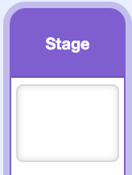
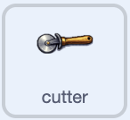
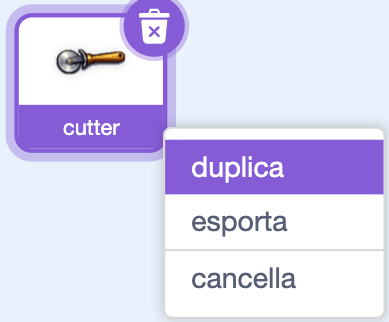
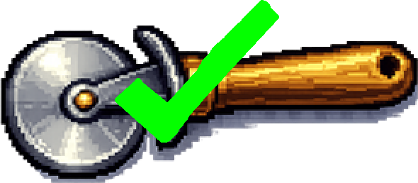

## Aggiungi il primo equipaggiamento

Aggiungi equipaggiamento che il giocatore può sbloccare per rendere ogni clic più rilevante.

> [!TASK]
>
> Crea una variabile chiamata `pizze per clic`{:class="block3variables"}. Questo è quanto un clic aggiunge al punteggio del progetto demo.
>
> Se la variabile del punteggio non è `pizze`{:class="block3variables"}, assegna a questa variabile un nome corrispondente, come `monete per clic` o `obiettivi per clic`.

> [!TIP]
>
> Tutte le informazioni che un gioco memorizza e che cambiano nel tempo, come punteggi, prezzi e potenziamenti, vengono definite **stato del gioco**.

> [!TASK]
>
> Fai clic su `Stage`{:class="block3looks"} e imposta `pizze per click`{:class="block3variables"} su `1` sullo script della bandierina verde, in modo che un clic ne aggiunga sempre almeno una.
>
> 
>
> ```blocks3
> when green flag clicked
> set [pizzas v] to (0)
> +set [pizzas per click v] to (1)
> ```

> [!TASK]
>
> Nel tuo sprite principale del clicker, fai in modo che ogni clic utilizzi la variabile invece di un valore fisso `1`.
>
> <p align="center"></p>
>
> ```blocks3
> when this sprite clicked
> start sound (Tennis Hit v)
> +change [pizzas v] by (pizzas per click)
> change size by (10)
> wait (0.05) seconds
> change size by (-10)
> ```

Ancora non cambia nulla, perché `pizze per click`{:class="block3variables"} è rimasto a `1`. L'attrezzatura lo potenzierà.

> [!TASK]
>
> Aggiungi il tuo primo elemento di equipaggiamento come nuovo sprite. Scegli qualcosa che sembri migliorare ogni clic, come uno strumento, una macchina, un potenziamento o un badge. Il progetto dimostrativo utilizza una taglierina.
>
> Usa il tuo equipaggiamento oppure salva [lo sprite della taglierina](images/cutter-sprite.png) e caricalo con **Importa**.
>
> 

> [!TASK]
>
> Seleziona lo sprite dell'attrezzatura e usa la casella **Dimensione** sotto lo Stage per adattarlo. Il taglierino del progetto dimostrativo ha una dimensione del 30%.
>
> Trascinalo vicino alla parte inferiore dello Stage, lasciando spazio per altri due sprite di equipaggiamento accanto ad esso.

> [!TASK]
>
> Nella scheda **Costumi**, fai clic con il pulsante destro del mouse sul costume dell'equipaggiamento e scegli **duplica**. Mantieni il costume semplice prima e il costume copiato in seconda posizione.
>
> 

> [!TASK]
>
> Modifica il secondo costume in modo che mostri chiaramente che l'attrezzatura è stata acquistata. Il progetto demo aggiunge un segno di spunta verde.
>
> 

> [!TASK]
>
> Aggiungi il suono `Alert`{:class="block3sound"} allo sprite del tuo equipaggiamento.

> [!TASK]
>
> Posiziona l'equipaggiamento sullo script della bandierina verde: rendilo non trascinabile, passa al costume normale e nascondilo.
>
> <p align="center"></p>
>
> ```blocks3
> when green flag clicked
> set drag mode [not draggable v]
> switch costume to (cutter v)
> hide
> ```

> [!TASK]
>
> Fai apparire l'equipaggiamento solo una volta che il giocatore può permetterselo. Il suono e il fumetto comunicano al giocatore cosa è appena apparso.
>
> La taglierina costa `25` punti della variabile punteggio, quindi appare quando il giocatore ha più di `24`. Utilizzare numeri più grandi per rendere più costose le apparecchiature successive.
>
> ```blocks3
> when green flag clicked
> set drag mode [not draggable v]
> switch costume to (cutter v)
> hide
> +wait until <(pizzas) > (24)>
> +show
> +start sound (Alert v)
> +say [New equipment unlocked!] for (2) seconds
> ```

> [!TIP]
>
> Una **condizione di sblocco** è una regola che rende qualcosa disponibile solo dopo che il giocatore ha fatto abbastanza.

> [!TASK]
>
> Aggiungi il suono `Tada`{:class="block3sound"} allo sprite del tuo equipaggiamento.

> [!TASK]
>
> Rendilo acquistabile. Verifica che la taglierina abbia ancora il suo primo costume e che il giocatore abbia almeno `25` pizze. Sottrai il suo costo, potenzia i clic del giocatore, quindi passa al costume "acquistato". Il costume ci ricorda che l'acquisto è avvenuto, quindi i clic successivi non hanno alcun effetto.
>
> <p align="center"></p>
>
> ```blocks3
> when this sprite clicked
> if <<(costume [number v]) = (1)> and <(pizzas) > (24)>> then
> start sound (Tada v)
> change [pizzas v] by (-25)
> set [pizzas per click v] to (2)
> next costume
> end
> ```

Clicca fino a quando il punteggio raggiunge 25. Acquista il taglierino e verifica che il punteggio scenda di 25, che appaia il segno di spunta verde e che ogni clic valga ora 2. Fai di nuovo clic sul taglierino: il punteggio e il costume dovrebbero rimanere invariati. Riavvia il gioco e verifica se puoi acquistarlo di nuovo.

> [!TIP]
>
> Spesso gli sviluppatori di videogiochi creano e testano prima un singolo **prototipo** funzionante. Sistemare gli script della taglierina prima di copiarli rende più facile individuare i problemi.
