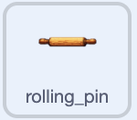
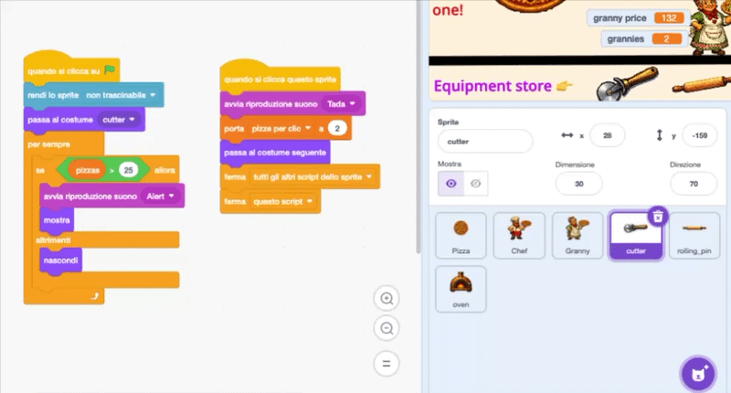
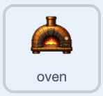

## Aggiungi altro equipaggiamento

Parti dal prototipo della taglierina con altri due potenziamenti che rendono ogni clic ancora più prezioso.

> [!TASK]
>
> Aggiungi un mattarello come nuovo sprite.
>
> 
>
> Usa il tuo equipaggiamento oppure salva [lo sprite del mattarello](images/rolling-pin-sprite.png) e caricalo con **Importa**.

> [!TASK]
>
> Utilizza la casella **Dimensione** sotto lo Stage per ridimensionare il mattarello, quindi trascinalo accanto alla rotella. Il mattarello del progetto demo ha una dimensione del 30%.

> [!TASK]
>
> Apri la scheda **Costumi** del mattarello. Fai clic con il pulsante destro del mouse sul costume e scegli **duplica**, mantenendo il costume originale prima e la copia dopo.
>
> Aggiungi un segno di spunta verde al secondo costume in modo che il giocatore possa vedere quando il mattarello è stato acquistato.

> [!TASK]
>
> Copia i due script della taglierina sul mattarello trascinando ciascuno script sul mattarello nell'elenco degli sprite. Aggiungi anche i suoni `Alert`{:class="block3sound"} e `Tada`{:class="block3sound"}.
>
> > [!NOPRINT]
> >
> > 

> [!TASK]
>
> Aggiorna gli script copiati per il mattarello. Costa `500` e porta `pizze per clic`{:class="block3variables"} a `6`.
>
> <p align="center"></p>
>
> ```blocks3
> when green flag clicked
> set drag mode [not draggable v]
> switch costume to (rolling_pin v)
> hide
> wait until <(pizze) > (499)>
> show
> start sound (Alert v)
> say [Nuovo equipaggiamento sbloccato!] for (2) seconds
> ```
>
> ```blocks3
> when this sprite clicked
> if <<(costume [number v]) = (1)> and <(pizze) > (499)>> then
> start sound (Tada v)
> change [pizze v] by (-500)
> set [pizze per clic v] to (6)
> next costume
> end
> ```

Clicca fino a quando il punteggio raggiunge 500. Il mattarello appare; cliccaci sopra per acquistarlo e verifica che appaia il suo costume con la spunta verde.

> [!TASK]
>
> Aggiungi un forno come nuovo sprite.
>
> 
>
> Usa il tuo equipaggiamento oppure salva [lo sprite del forno](images/oven-sprite.png) e caricalo con **Importa**.

> [!TASK]
>
> Ridimensiona il forno e trascinalo accanto agli altri equipaggiamenti. Il forno del progetto demo ha una dimensione del 17%.

> [!TASK]
>
> Apri la scheda **Costumi** del forno. Fai clic con il pulsante destro del mouse sul costume e scegli **duplica**, mantenendo il costume originale prima e la copia dopo.
>
> Aggiungi un segno di spunta verde al secondo costume in modo che il giocatore possa vedere quando il forno è stato acquistato.

> [!TASK]
>
> Copia i due script del mattarello sul forno trascinando ciascuno script sul forno nell'elenco degli sprite. Aggiungi anche i suoni `Alert`{:class="block3sound"} e `Tada`{:class="block3sound"}.

> [!TASK]
>
> Aggiorna gli script copiati per il forno. Costa `3000` e porta `pizze per click`{:class="block3variables"} a `24`.
>
> <p align="center"></p>
>
> ```blocks3
> when green flag clicked
> set drag mode [not draggable v]
> switch costume to (oven v)
> hide
> wait until <(pizze) > (2999)>
> show
> start sound (Alert v)
> say [Nuovo equipaggiamento sbloccato!] for (2) seconds
> ```
>
> ```blocks3
> when this sprite clicked
> if <<(costume [number v]) = (1)> and <(pizze) > (2999)>> then
> start sound (Tada v)
> change [pizze v] by (-3000)
> set [pizze per clic v] to (24)
> next costume
> end
> ```

Clicca fino a quando il punteggio raggiunge 3000. Acquista il forno e verifica che appaia il suo costume con la spunta verde e ogni clic valga 24. A questo punto, gli aiutanti possono anche guadagnare le pizze necessarie per sbloccare l'equipaggiamento; il fumetto chiarisce il significato dell'avviso.

> [!TASK]
>
> Per vincere, fai in modo che un giocatore abbia bisogno di ottenere tutti gli equipaggiamenti. Sullo sprite principale del tuo clicker, aggiorna `attendi fino a quando`{:class="block3control"} in modo che il giocatore abbia bisogno di un punteggio alto **e** di tutto l'equipaggiamento (che imposta `pizze per clic`{:class="block3variables"} a `24` nel progetto demo).
>
> <p align="center"></p>
>
> ```blocks3
> when green flag clicked
> set drag mode [not draggable v]
> +wait until <<(pizze) > (10000)> and <(pizze per clic) = (24)>>
> start sound (Win v)
> say [Hai vinto!] for (2) seconds
> stop [tutto v]
> ```

Acquista tutti e tre i pezzi di equipaggiamento. Il messaggio di vittoria ora appare solo quando il progetto demo è completamente configurato.
