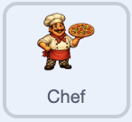
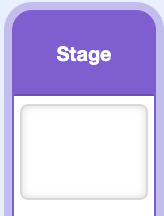
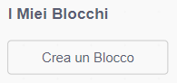

## Aggiungi i clicker automatici

Aggiungi un aiutante che prepara pizze ogni secondo, anche quando il giocatore smette di cliccare. Il giocatore può assumere lo stesso tipo di aiutante più di una volta, e ognuno di essi aggiunge una pizza in più al secondo.

> [!TASK]
>
> Aggiungi uno sprite di supporto. Scegli un personaggio o una macchina che sembri in grado di funzionare automaticamente. Il progetto dimostrativo utilizza uno chef.
>
> 
>
> Utilizza il tuo assistente, oppure salva [lo sprite dello chef](images/chef-sprite.png) e importalo con **Importa**.

> [!TASK]
>
> Seleziona l'aiutante e usa la casella **Dimensione** sotto lo Stage per adattarlo. Lo chef del progetto dimostrativo ha una dimensione del 30%.
>
> Trascinalo su una parte vuota dello Stage dove non coprirà il punteggio o l'equipaggiamento. Il progetto dimostrativo mette lo chef sulla destra.

> [!TASK]
>
> Aggiungi il suono `Clang`{:class="block3sound"} allo sprite di supporto.

> [!TASK]
>
> Crea una variabile chiamata `chef`{:class="block3variables"}. Questo campo memorizza il numero di chef assunti dal giocatore.

> [!TASK]
>
> Crea una variabile chiamata `prezzo chef`{:class="block3variables"}. Memorizza il costo delle pizze per il prossimo chef.

> [!TASK]
>
> Crea una variabile chiamata `pizze al secondo`{:class="block3variables"}. Mostra quante pizze preparano tutti gli aiutanti in ogni secondo.

> [!TASK]
>
> Fai clic su `Stage`{:class="block3looks"} e assegna i valori iniziali alle variabili degli aiutanti sul clic alla bandierina verde.
>
> Il primo aiutante costa `50`, quindi la taglierina si sblocca comunque per prima a `25`.
>
> 
>
> ```blocks3
> when green flag clicked
> set [pizzas v] to (0)
> set [pizzas per click v] to (1)
> +set [chefs v] to (0)
> +set [chef price v] to (50)
> +set [pizzas per second v] to (0)
> ```

Clicca sulla bandierina verde. Le nuove variabili dovrebbero mostrare `chef 0`, `prezzo chef 50`, e `pizze al secondo 0`.

> [!TASK]
>
> Sullo sprite dell'aiutante, inizia il suo script di acquisto. Cliccando sull'assistente, si spende il prezzo corrente e si assume un assistente.
>
> Nel blocco `cambia`{:class="block3variables"} va usato di un numero negativo per spendere le pizze. `0 - prezzo dello chef` converte il prezzo in quel numero negativo.
>
> <p align="center"></p>
>
> ```blocks3
> when this sprite clicked
> start sound (Clang v)
> change [pizzas v] by ((0) - (chef price))
> change [chefs v] by (1)
> ```

> [!TASK]
>
> Aggiungi un blocco per far sì che il prossimo aiutante costi circa il 15% in più.
>
> Moltiplicando per `1,15` si aggiunge il 15% al vecchio prezzo. `arrotonda`{:class="block3operators"} mantiene il nuovo prezzo come un numero intero.
>
> ```blocks3
> quando si clicca questo sprite
> avvia riproduzione suono (Clang v)
> cambia [pizze v] di ((0) - (prezzo chef))
> cambia [chef v] di (1)
> +porta [prezzo chef v] a (arrotonda ((prezzo chef) * (1.15)))
> ```

Il primo aiutante costa 50 pizze. Dopo l'acquisto, `chefs` dovrebbe essere `1` e `chef price` dovrebbe essere `58`.

> [!TIP]
>
> Una **curva di progressione** controlla la velocità con cui un gioco diventa più difficile, più veloce o più costoso man mano che il giocatore migliora.

> [!TASK]
>
> Fai apparire l'aiutante solo quando il giocatore può permettersi il prezzo corrente.
>
> Scratch non ha un blocco `maggiore o uguale a`. Poiché il punteggio utilizza numeri interi, verificare la condizione `pizze > prezzo dello chef - 1` produce lo stesso risultato.
>
> <p align="center"></p>
>
> ```blocks3
> when green flag clicked
> set drag mode [not draggable v]
> hide
> forever
> if <(pizzas) > ((chef price) - (1))> then
> show
> else
> hide
> end
> end
> ```

Fai clic sulla bandierina verde e poi sullo sprite principale. L'aiutante dovrebbe rimanere nascosto fino a 49 pizze e apparire quando il punteggio raggiunge i 50.

> [!TASK]
>
> Clicca su `Stage`{:class="block3looks"}. Nella sezione `I Miei Blocchi`{:class="block3custom"}, fai clic su **Crea un blocco**, chiamalo `aggiorna pizze al secondo`{:class="block3custom"} e crea la sua definizione.
>
> Ogni chef prepara una pizza al secondo, quindi la velocità è la stessa del numero memorizzato in `chef`{:class="block3variables"}.
>
> 
>
> 
>
> ```blocks3
> define update pizzas per second
> set [pizzas per second v] to (chefs)
> ```

> [!TIP]
>
> In molti linguaggi di programmazione, un blocco di codice riutilizzabile come questo è chiamato **funzione**.

> [!TASK]
>
> Sempre sullo Stage, aggiungi uno script che esegua il nuovo blocco ogni volta che un assistente richiede l'aggiornamento della tariffa.
>
> Nel blocco `quando ricevo`{:class="block3events"}, apri il menu dei messaggi, scegli **Nuovo messaggio** e assegnagli il nome `aggiornamento`.
>
> ```blocks3
> when I receive (update v)
> update pizzas per second :: custom
> ```

> [!TASK]
>
> Torna allo sprite dell'aiutante. Trasmetti `aggiornamento` alla fine del suo script di acquisto in modo che lo Stage ricalcoli la tariffa dopo ogni acquisto.
>
> ```blocks3
> when this sprite clicked
> start sound (Clang v)
> change [pizzas v] by ((0) - (chef price))
> change [chefs v] by (1)
> set [chef price v] to (round ((chef price) * (1.15)))
> +broadcast (update v)
> ```

> [!TASK]
>
> Sullo Stage, completa lo script della bandierina verde con il tempo di gioco. Ogni secondo, aggiunge il valore corrente di `pizze al secondo`{:class="block3variables"} al punteggio.
>
> ```blocks3
> when green flag clicked
> set [pizzas v] to (0)
> set [pizzas per click v] to (1)
> set [chefs v] to (0)
> set [chef price v] to (50)
> update pizzas per second :: custom
> forever
> wait (1) seconds
> change [pizzas v] by (pizzas per second)
> end
> ```

> [!TIP]
>
> Il momento in cui un gioco aggiorna puntualmente i suoi numeri si chiama **tick**. Questo clicker ha un tick ogni secondo.

Clicca sulla bandierina verde, guadagna 50 pizze e assumi un aiutante. Verifica che `chef` diventi `1` e `pizze al secondo` diventi `1`, quindi smetti di cliccare. Il punteggio dovrebbe aumentare di un punto ogni secondo.

L'aiutante è un miglioramento ripetibile. Quando il punteggio raggiunge il nuovo prezzo, lo sprite riappare in modo che il giocatore possa fare un'altra assunzione.
