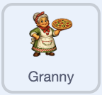
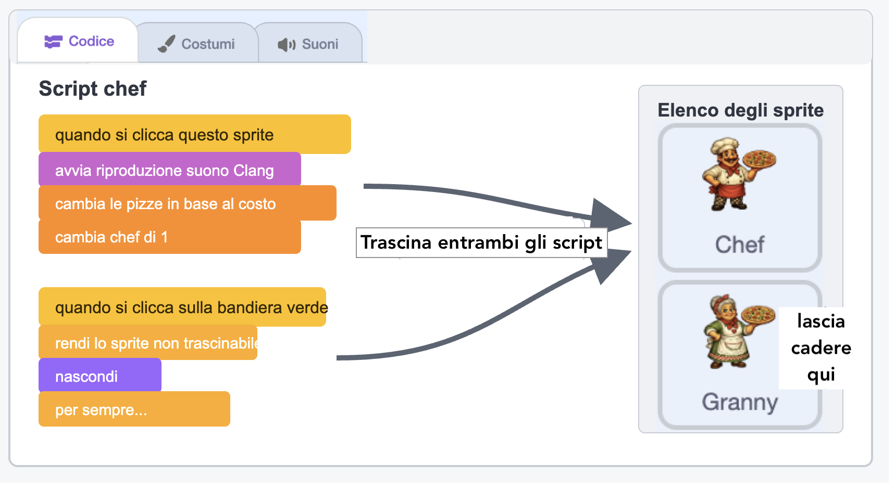
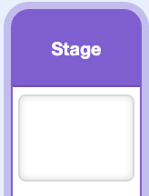

## Aggiungi un secondo aiutante

Aggiungi un secondo aiutante più potente che prepara cinque pizze al secondo invece di una.

> [!TASK]
>
> Aggiungi un altro sprite di supporto. Il progetto dimostrativo utilizza una nonna.
>
> 
>
> Usa il tuo helper, o salva [lo sprite granny](images/granny-sprite.png) e importalo con **Importa Sprite**.

> [!TASK]
>
> Utilizza la casella **Dimensione** sotto lo Stage per ridimensionare il secondo assistente, quindi trascinalo in una posizione libera. La nonna del progetto dimostrativo ha una dimensione del 30% e si trova sotto lo chef sulla destra.

> [!TASK]
>
> Copia i due script del tuo primo aiutante sul nuovo sprite: trascina ciascuno script dall'area del codice e rilascialo sul nuovo sprite nell'elenco degli sprite.
>
> > [!NOPRINT]
> >
> > 

> [!TASK]
>
> Crea una variabile chiamata `nonne`{:class="block3variables"} per indicare quante aiutanti nonne sono state assunte.

> [!TASK]
>
> Crea una variabile chiamata `prezzo della nonna`{:class="block3variables"} per indicare quante pizze costa la prossima nonna.

> [!TASK]
>
> Aggiungi il suono `Collect`{:class="block3sound"} al secondo sprite di supporto.

> [!TASK]
>
> Fai clic su `Stage`{:class="block3looks"} e aggiungi i valori iniziali per le nuove variabili. Il secondo aiutante inizia con `100` pizze perché lavora cinque volte più velocemente.
>
> 
>
> ```blocks3
> when green flag clicked
> set [pizze v] to (0)
> set [pizze per clic v] to (1)
> set [chef v] to (0)
> set [prezzo chef v] to (50)
> +set [nonne v] to (0)
> +set [prezzo della nonna v] to (100)
> aggiorna pizze al secondo :: custom
> forever
> wait (1) seconds
> change [pizze v] by (pizze al secondo)
> end
> ```

Clicca sulla bandierina verde. Le nuove variabili dovrebbero mostrare `nonne 0` e `prezzo della nonna 100`.

> [!TASK]
>
> Nel secondo aiutante, aggiorna lo script di acquisto copiato in modo che utilizzi il suo suono, il conteggio e il prezzo.
>
> Il blocco `invia a tutti`{:class="block3events"} rimane alla fine perché l'acquisto di uno dei due tipi di aiutante modifica la velocità delle pizze al secondo.
>
> <p align="center"></p>
>
> ```blocks3
> when this sprite clicked
> start sound (Collect v)
> change [pizze v] by ((0) - (prezzo della nonna))
> change [nonne v] by (1)
> set [prezzo della nonna v] to (round ((prezzo della nonna) * (1.15)))
> broadcast (aggiorna v)
> ```

> [!TASK]
>
> Aggiorna lo script copiato, quello che parte con la bandierina verde, affinché il secondo aiutante venga mostrato solo quando il suo costo è sostenibile.
>
> <p align="center"></p>
>
> ```blocks3
> when green flag clicked
> set drag mode [non trascinabile v]
> hide
> forever
> if <(pizze) > ((prezzo della nonna) - (1))> then
> show
> else
> hide
> end
> end
> ```

Clicca sulla bandierina verde e fai salire il punteggio. Il primo aiutante dovrebbe apparire a 50 pizze e il secondo aiutante a 100 pizze.

> [!TASK]
>
> Su `Stage`{:class="block3looks"}, aggiorna la definizione di `aggiorna pizze al secondo`{:class="block3custom"}.
>
> Il numero degli chef rappresenta già il loro contributo, poiché ognuno prepara una pizza al secondo. Ogni nonnina ne fa cinque, quindi moltiplica solo `nonne`{:class="block3variables"} per `5`.
>
> 
>
> ```blocks3
> define aggiorna pizze al secondo
> set [pizze al secondo v] to ((chef) + ((nonne) * (5)))
> ```

> [!TIP]
>
> La scelta dei costi e delle ricompense in modo che ogni potenziamento risulti vantaggioso si chiama **bilanciamento del gioco**.

Assumi un primo aiutante e una nonna. `pizze al secondo` dovrebbe diventare `6`: una dal primo aiutante e cinque dalla nonna. Smetti di cliccare e controlla che il punteggio aumenti di sei ogni secondo.

Ora disponi di un clicker infinito e completo: clic, equipaggiamento e aiutanti a ripetizione, tutti funzionanti insieme.

> [!TIP]
>
> Cliccare, guadagnare, acquistare potenziamenti e poi guadagnare più velocemente costituiscono il **ciclo principale** del gioco.
