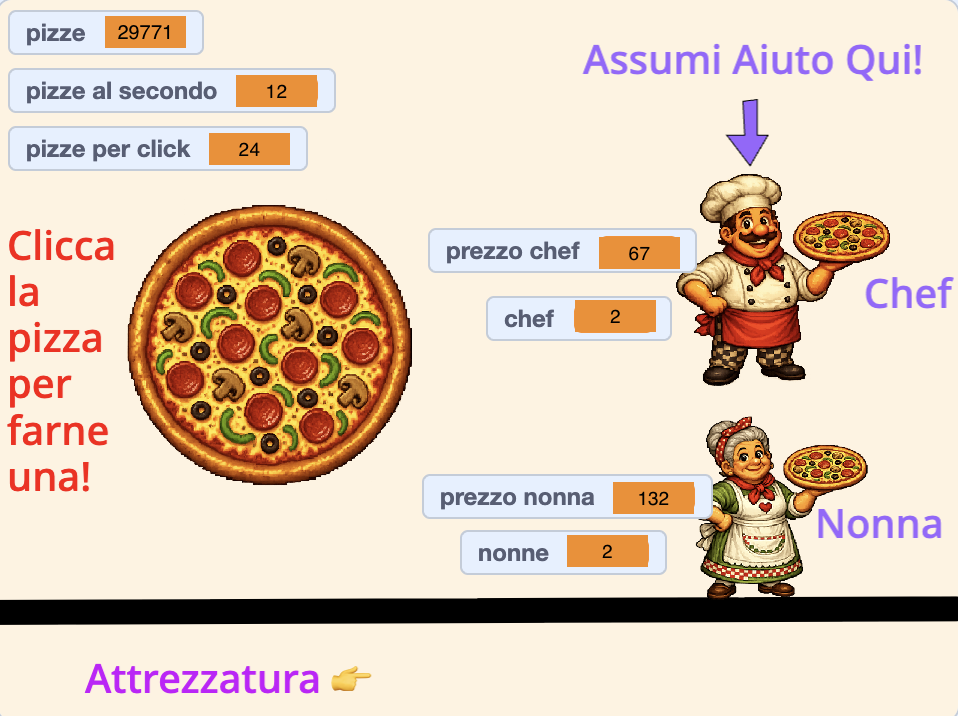

## Aggiungere uno sfondo

In questo momento il gioco funziona, ma forse è troppo semplice. Dai al gioco una vetrina adeguata e sistema le informazioni in modo che il giocatore sappia cosa significa ogni elemento.

> [!TASK]
>
> Disegna un nuovo sfondo. Passa il mouse sopra **Scegli uno sfondo** (in basso a destra) e fai clic su **Disegna un nuovo sfondo** per crearne uno vuoto.

> [!TASK]
>
> Usa lo strumento **Testo** nell'editor di disegno per aggiungere etichette e istruzioni. La pizzeria utilizza "Clicca la pizza per farne una!", "Assumere Aiuto Qui!", e "Attrezzature". Usa le tue parole e i tuoi colori.

> [!TASK]
>
> Trascina i tuoi sprite nella posizione desiderata sullo Stage. Nella pizzeria, la pizza è al centro, il cuoco e la nonna sono a destra e le attrezzature sono in basso.

> [!TASK]
>
> Trascina ciascun contatore nella posizione desiderata. La pizzeria mette in alto a sinistra `pizze`{:class="block3variables"}, `pizze al secondo`{:class="block3variables"} e `pizze per clic`{:class="block3variables"}, posiziona `prezzo chef`{:class="block3variables"} e `chef`{:class="block3variables"} accanto allo chef, e `prezzo della nonna`{:class="block3variables"} e `nonne`{:class="block3variables"} accanto alla nonna.

> [!TIP]
>
> Il punteggio, i prezzi e le altre informazioni visualizzate in alto nello schermo di gioco sono spesso chiamate **HUD**, abbreviazione di **heads-up display**.

Fai clic sulla bandierina verde e confronta il tuo layout con l'esempio. Verifica che ogni sprite e variabile siano visibili, che nulla copra le istruzioni e che gli sprite degli aiutanti siano sufficientemente piccoli da poter essere posizionati a destra. Il tuo gioco può avere l'aspetto che preferisci.

