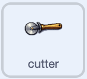

## Rendi l'equipaggiamento animato

Fai in modo che le tue attrezzature si muovano, così la loro sezione sembrerà più vivace.

> [!TASK]
>
> Aggiungi questo script al tuo primo pezzo di equipaggiamento. Orienta lo sprite in direzione `90` per iniziare il livello, quindi lo fa oscillare avanti e indietro all'infinito.
>
> <p align="center"></p>
>
> ```blocks3
> when green flag clicked
> point in direction (90)
> forever
> turn right (10) degrees
> wait (0.2) seconds
> turn left (10) degrees
> wait (0.2) seconds
> turn left (10) degrees
> wait (0.2) seconds
> turn right (10) degrees
> wait (0.2) seconds
> end
> ```

> [!TASK]
>
> Aggiungi lo stesso script agli altri sprite delle tue attrezzature trascinandolo su ciascuno di essi nell'elenco degli sprite.

Clicca sulla bandierina verde. Ogni sprite dell'equipaggiamento dovrebbe oscillare delicatamente da un lato all'altro e tornare alla sua direzione iniziale dopo ogni oscillazione.
