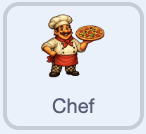

## Anima i clicker automatici

Fai pulsare leggermente i tuoi aiutanti, in modo che sembrino indaffarati al lavoro.

> [!TASK]
>
> Aggiungi questo script al tuo primo assistente. Ingrandisce leggermente lo sprite, poi lo rimpicciolisce, ripetendo il processo più e più volte.
>
> <p align="center"></p>
>
> ```blocks3
> when green flag clicked
> forever
> repeat (5)
> change size by (2)
> wait (0.05) seconds
> end
> repeat (5)
> change size by (-2)
> wait (0.05) seconds
> end
> end
> ```

> [!TASK]
>
> Aggiungi lo stesso script all'altro aiutante trascinandolo su di esso nell'elenco degli sprite.

Clicca sulla bandierina verde. Ogni aiutante dovrebbe crescere di 10 in totale, ridursi di 10 e tornare alla sua dimensione di partenza prima dell'impulso successivo. Lascia il gioco in esecuzione e controlla che gli aiutanti continuino a pulsare mentre il punteggio sale ancora ogni secondo.

> [!TIP]
>
> Piccole animazioni che rendono un gioco più vivace senza cambiarne le regole fanno parte del **sentimento di gioco**, a volte chiamato **succo**.

> [!SAVE]

***
Questo progetto è stato tradotto da volontari:

Fabrizio Tringali

Pierangela Trovato

Grazie ai volontari, possiamo offrire alle persone di tutto il mondo la possibilità di imparare nella loro lingua. Puoi aiutarci a raggiungere più persone offrendoti come volontario per la traduzione - puoi trovare maggiori informazioni su [rpf.io/translate](https://rpf.io/translate).
