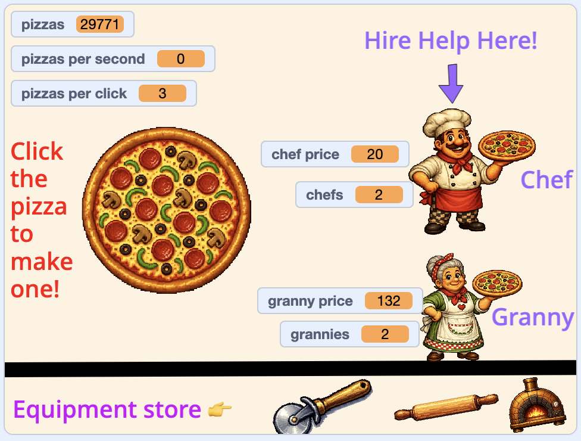

## Wat ga je maken

Bouw een eindeloze klikker waar spelers één ding aanklikken, upgrades kopen en de getallen sneller zien groeien.

> [!NOPRINT]
>
> 

>  <iframe allowtransparency="true" width="485" height="402" src="https://scratch.mit.edu/projects/embed/1361881665/?autostart=false" frameborder="0"></iframe>
> 

> [!PRINTONLY]
>
> 

Speel de demo en maak daarna je eigen versie!

### Je hebt nodig:

- De Scratch-editor
- Een nieuw Scratch-project
