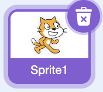
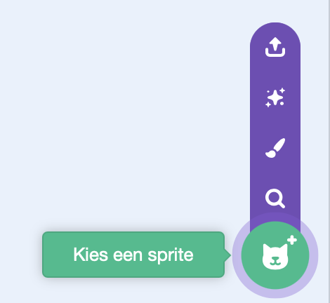
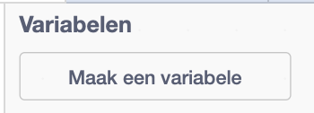
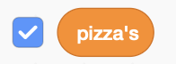
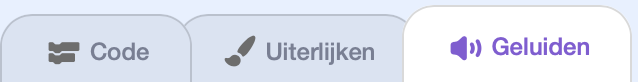

## Maak de clicker

Voeg iets toe om op te klikken en een score die omhoog gaat wanneer je erop klikt.

> [!TASK]
>
> Open een [nieuw Scratch-project](https://scratch.mit.edu/projects/editor/){:target="_blank"} in een nieuw tabblad.

> [!TASK]
>
> Verwijder de kat-sprite door op prullenbaksymbool te klikken.
>
> 

> [!TASK]
>
> Voeg je eigen sprite toe met **Kies een sprite** (bibliotheek, **Upload sprite** of **Teken**).
>
> 
>
> Kies één duidelijk object waarop spelers vaak kunnen klikken, zoals eten, een schat, een mascotte, een bal of iets dat je zelf hebt getekend. Het demo-project gebruikt een pizza.
>
> Gebruik je eigen sprite, of sla [de pizzasprite](images/pizza-sprite.png) op en importeer deze met **Upload sprite**.
>
> 

> [!TASK]
>
> Maak een scorevariabele aan en geef deze een logische meervoudsnaam, zoals 'pizza's', 'munten', 'doelpunten' of 'sterren'. Vink deze aan zodat de speler zijn score kan zien.
>
> De demoblokken gebruiken `pizza's`{:class="block3variables"}. Als je een andere naam kiest, gebruik dan jouw variabele overal waar je `pizza's`{:class="block3variables"} ziet.
>
> 
>
> 

> [!TASK]
>
> Maak je sprite klikbaar zodat elke klik je scorevariabele verhoogt.
>
> <p align="center"></p>
>
> ```blocks3
> when this sprite clicked
> change [pizzas v] by (1)
> ```

Klik op je sprite. Je scorevariabele gaat omhoog.

> [!TASK]
>
> Voeg een geluid toe, zodat een klik leuk klinkt. Open het tabblad **Geluiden**, klik op het luidsprekerpictogram en kies een kort geluid.
>
> 
>
> Voeg het toe aan de bovenkant van je script. Gebruik in dit project `start geluid`{:class="block3sound"}, en niet `start geluid en wacht `{:class="block3sound"}, zodat het geluid start zonder de rest van het programma te blokkeren.
>
> ```blocks3
> when this sprite clicked
> +start sound (Tennis Hit v)
> change [pizzas v] by (1)
> ```

> [!TIP]
>
> Code die iets begint en vervolgens blijft doorgaan heet **niet-blokkerend** omdat het de rest van het programma niet pauzeert.

> [!TASK]
>
> Laat de sprite stuiteren door de grootte ervan te veranderen wanneer erop geklikt wordt.
>
> <p align="center"></p>
>
> ```blocks3
> when this sprite clicked
> start sound (Tennis Hit v)
> change [pizzas v] by (1)
> +change size by (10)
> +wait (0.05) seconds
> +change size by (-10)
> ```

> [!TIP]
>
> **Visuele feedback** laat de speler zien dat een actie is gelukt. Door het stuiteren voelt elke klik echt aan, zelfs voordat de speler de score controleert.

> [!TASK]
>
> Begin een nieuw script. Wanneer op groene vlag wordt geklikt moet de sprite de eigenschap `niet sleepbaar` krijgen, zodat de speler erop klikt in plaats van hem per ongeluk over het speelveld te slepen.
>
> <p align="center"></p>
>
> ```blocks3
> when green flag clicked
> set drag mode [not draggable v]
> ```

> [!TASK]
>
> Voeg het `Win`{:class="block3sound"} geluid toe aan je clicker-sprite.

> [!TASK]
>
> Voeg de **winstvoorwaarde** toe aan hetzelfde script. Deze wacht tot de score hoog genoeg is en viert dan de winst.
>
> ```blocks3
> wanneer op de groene vlag wordt geklikt
> zet sleepbaar op [niet sleepbaar v]
> +wacht tot <(pizza's) > (10000)>
> +start geluid (Win v)
> +zeg [Je hebt gewonnen!] (2) sec.
> +stop [alle v]
> ```

> [!TIP]
>
> Een **winstvoorwaarde** is de regel die bepaalt wanneer een speler een spel heeft voltooid of gewonnen.

> [!TASK]
>
> Klik op het`Speelveld`{:class="block3looks"} en zet de score op 0 wanneer op de groene vlag wordt geklikt.
>
> 
>
> ```blocks3
> when green flag clicked
> set [pizzas v] to (0)
> ```

> [!TASK]
>
> **Test:** Klik op de groene vlag. Je score zou bij 0 moeten beginnen en oplopen bij elke klik.
