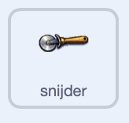
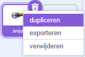
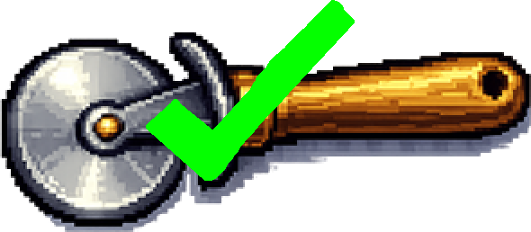

## Voeg het eerste apparaat toe

Voeg apparatuur toe die de speler kan vrijspelen, zodat elke klik meer waarde heeft.

> [!TASK]
>
> Maak een variabele aan met de naam `pizza's per klik`{:class="block3variables"}. Dit is hoeveel één klik toevoegt aan de score van het demoproject.
>
> Als je scorevariabele niet `pizza's`{:class="block3variables"} heet, geef deze variabele dan een overeenkomende naam, zoals `munten per klik` of `goals per klik`.

> [!TIP]
>
> Alle veranderende informatie die een spel onthoudt, zoals scores, prijzen en upgrades, wordt de **spelstatus** genoemd.

> [!TASK]
>
> Klik op het `Speelveld`{:class="block3looks"} en stel `pizzas per klik`{:class="block3variables"} in op `1` wanneer op groene vlag wordt geklikt, zodat er bij elke klik altijd minstens één pizza wordt toegevoegd.
>
> 
>
> ```blocks3
> when green flag clicked
> set [pizzas v] to (0)
> +set [pizzas per click v] to (1)
> ```

> [!TASK]
>
> Zorg ervoor dat bij je hoofdclicker-sprite elke klik de variabele waarde gebruikt in plaats van een vaste waarde van `1`.
>
> <p align="center"></p>
>
> ```blocks3
> when this sprite clicked
> start sound (Tennis Hit v)
> +change [pizzas v] by (pizzas per click)
> change size by (10)
> wait (0.05) seconds
> change size by (-10)
> ```

Er verandert nog niets, want `pizza's per klik`{:class="block3variables"} is nog steeds `1`. De apparatuur zal het vermeerderen.

> [!TASK]
>
> Voeg je eerste apparaat toe als een nieuwe sprite. Kies iets dat eruitziet alsof het elke muisklik zou verbeteren, zoals een gereedschap, machine, power-up of badge. Het demo-project gebruikt een pizzasnijder.
>
> Gebruik je eigen apparatuur, of sla [de snijder-sprite](images/cutter-sprite.png) op en importeer deze met **Upload sprite**.
>
> 

> [!TASK]
>
> Selecteer de apparatuursprite en gebruik het **Grootte**-vak onder het speelveld om deze passend te maken. De snijder van het demoproject heeft een grootte van 30%.
>
> Sleep het naar de onderkant van het speelveld, zodat er ruimte overblijft voor nog twee apparatuursprites ernaast.

> [!TASK]
>
> In het tabblad **Uiterlijken** klik je met de rechtermuisknop op het uiterlijk van het apparaat en kies je **dupliceren**. Houd het originele uiterlijk als eerste en het gekopieerde uiterlijk als tweede.
>
> 

> [!TASK]
>
> Verander het tweede uiterlijk zodat duidelijk te zien is dat het apparaat is aangeschaft. Het demo-project voegt een groene vinkje toe.
>
> 

> [!TASK]
>
> Voeg het `Alert`{:class="block3sound"} geluid toe aan je apparatuursprite.

> [!TASK]
>
> Stel de apparatuur in op wanneer op groene vlag wordt geklikt: maak deze niet sleepbaar, schakel over naar het originele uiterlijk en verberg deze.
>
> <p align="center"></p>
>
> ```blocks3
> when green flag clicked
> set drag mode [not draggable v]
> switch costume to (cutter v)
> hide
> ```

> [!TASK]
>
> Zorg ervoor dat de apparatuur pas verschijnt wanneer de speler het zich kan veroorloven. Het geluid en de tekstballon vertellen de speler wat er zojuist is verschenen.
>
> De snijder kost '25' punten van de scorevariabele, dus hij verschijnt wanneer de speler meer dan '24' punten heeft. Gebruik hogere getallen om latere apparatuur duurder te maken.
>
> ```blocks3
> when green flag clicked
> set drag mode [not draggable v]
> switch costume to (cutter v)
> hide
> +wait until <(pizzas) > (24)>
> +show
> +start sound (Alert v)
> +say [New equipment unlocked!] for (2) seconds
> ```

> [!TIP]
>
> Een **ontgrendelingsvoorwaarde** is een regel die iets pas beschikbaar maakt nadat de speler voldoende heeft gepresteerd.

> [!TASK]
>
> Voeg het `Tada`{:class="block3sound"} geluid toe aan je apparatuursprite.

> [!TASK]
>
> Maak het koopbaar. Controleer of de pizzasnijder nog steeds zijn eerste uiterlijk heeft en of de speler minstens '25' pizza's heeft. Trek de prijs ervan af, upgrade de clicks van de speler en schakel vervolgens over naar het 'gekochte' uiterlijk. Het uiterlijk onthoudt dat het is gekocht, dus latere clicks hebben geen effect.
>
> <p align="center"></p>
>
> ```blocks3
> when this sprite clicked
> if <<(costume [number v]) = (1)> and <(pizzas) > (24)>> then
> start sound (Tada v)
> change [pizzas v] by (-25)
> set [pizzas per click v] to (2)
> next costume
> end
> ```

Klik door tot de score 25 is. Koop de snijder en controleer of de score met 25 daalt, het groene vinkje verschijnt en elke klik nu 2 punten waard is. Klik nogmaals op de snijder: de score en het uiterlijk moeten hetzelfde blijven. Start het spel opnieuw op en controleer of je het weer kunt kopen.

> [!TIP]
>
> Spelontwikkelaars bouwen en testen vaak eerst een werkend **prototype**. Het verbeteren van fouten in de snijder voordat je de scripts kopieert zorgt er voor dat je problemen makkelijker opspoort.
