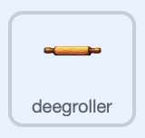
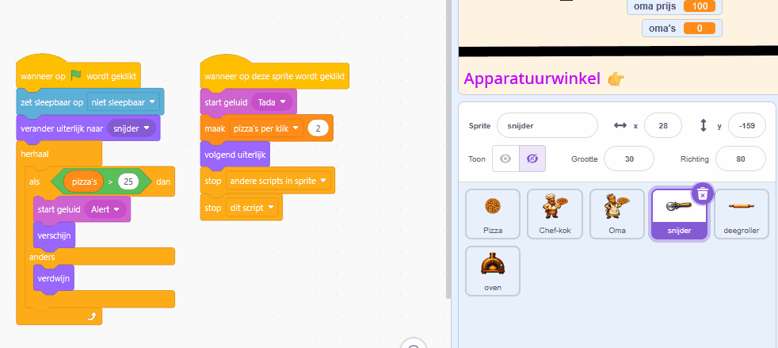
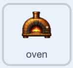
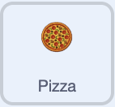

## Voeg meer apparatuur toe

Bouw voort op het prototype van de snijder met twee extra upgrades die elke klik nóg waardevoller maken.

> [!TASK]
>
> Voeg een deegroller toe als nieuwe sprite.
>
> 
>
> Gebruik je eigen apparatuur, of sla [de deegroller-sprite](images/rolling-pin-sprite.png) op en importeer deze met **Upload sprite**.

> [!TASK]
>
> Gebruik het vakje **Grootte** onder het Speelveld om de deegroller te vergroten of verkleinen en sleep hem vervolgens naast de snijder. De deegroller van het demoproject heeft een grootte van `30`%.

> [!TASK]
>
> Open het tabblad **Uiterlijken** van de deegroller. Klik met de rechtermuisknop op het uiterlijk en kies **dupliceren**. Bewaar eerst het originele uiterlijk en daarna het gekopieerde uiterlijk.
>
> Voeg een groen vinkje toe aan het tweede uiterlijk, zodat de speler kan zien wanneer de deegroller is gekocht.

> [!TASK]
>
> Kopieer de twee scripts van de snijder naar de deegroller door elk script in de sprite-lijst naar de deegroller te slepen. Voeg ook de geluiden `Alert`{:class="block3sound"} en `Tada`{:class="block3sound"} toe.
>
> > [!NOPRINT]
> >
> > 

> [!TASK]
>
> Werk de gekopieerde scripts voor de deegroller bij. Deze kost `500` en zet `pizza's per klik`{:class="block3variables"} op `6`.
>
> <p align="center"></p>
>
> ```blocks3
> when green flag clicked
> set drag mode [not draggable v]
> switch costume to (rolling_pin v)
> hide
> wait until <(pizzas) > (499)>
> show
> start sound (Alert v)
> say [New equipment unlocked!] for (2) seconds
> ```
>
> ```blocks3
> when this sprite clicked
> if <<(costume [number v]) = (1)> and <(pizzas) > (499)>> then
> start sound (Tada v)
> change [pizzas v] by (-500)
> set [pizzas per click v] to (6)
> next costume
> end
> ```

Klik door tot de score 500 is. De deegroller verschijnt; klik erop om hem te kopen en controleer of het bijbehorende kostuum met het groene vinkje verschijnt.

> [!TASK]
>
> Voeg een oven toe als nieuwe sprite.
>
> 
>
> Gebruik je eigen apparatuur, of sla [de oven-sprite](images/oven-sprite.png) op en importeer deze met **Upload sprite**.

> [!TASK]
>
> Verklein of vergroot de oven en sleep hem naast de andere apparatuur. De oven van het demoproject heeft een grootte van 17%.

> [!TASK]
>
> Open het tabblad **Uiterlijken** van de oven. Klik met de rechtermuisknop op het uiterlijk en kies **dupliceren**. Bewaar eerst het originele uiterlijk en daarna het gekopieerde uiterlijk.
>
> Voeg een groen vinkje toe aan het tweede uiterlijk, zodat de speler kan zien wanneer de oven is gekocht.

> [!TASK]
>
> Kopieer de twee scripts van de deegroller naar de oven door elk script in de sprite-lijst naar de oven te slepen. Voeg ook de geluiden `Alert`{:class="block3sound"} en `Tada`{:class="block3sound"} toe.

> [!TASK]
>
> Werk de gekopieerde scripts voor de oven bij. Deze kost `3000` en zet `pizza's per klik`{:class="block3variables"} op `24`.
>
> <p align="center"></p>
>
> ```blocks3
> when green flag clicked
> set drag mode [not draggable v]
> switch costume to (oven v)
> hide
> wait until <(pizzas) > (2999)>
> show
> start sound (Alert v)
> say [New equipment unlocked!] for (2) seconds
> ```
>
> ```blocks3
> when this sprite clicked
> if <<(costume [number v]) = (1)> and <(pizzas) > (2999)>> then
> start sound (Tada v)
> change [pizzas v] by (-3000)
> set [pizzas per click v] to (24)
> next costume
> end
> ```

Klik door tot de score 3000 is. Koop de oven en controleer of het groene vinkje verschijnt en of elke klik 24 punten waard is. Later kunnen helpers ook de laatste pizza verdienen die nodig is om apparatuur vrij te spelen; in het tekstballonnetje wordt duidelijk wat de melding betekent.

> [!TASK]
>
> Om te winnen, moet een speler alle upgrades zien te bemachtigen. Update in je hoofdklik-sprite de `wacht tot`{:class="block3control"} zodat de speler een hoge score **en** alle apparatuur nodig heeft (waardoor `pizza's per klik`{:class="block3variables"} in het demoproject op `24` wordt ingesteld).
>
> <p align="center"></p>
>
> ```blocks3
> when green flag clicked
> set drag mode [not draggable v]
> +wait until <<(pizzas) > (10000)> and <(pizzas per click) = (24)>>
> start sound (Win v)
> say [You Win!] for (2) seconds
> stop [all v]
> ```

Koop alle drie de apparaten. Het winstbericht verschijnt nu pas als het demoproject volledig is ingericht.
