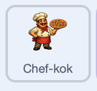
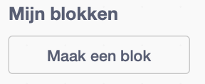

## Autoclickers toevoegen

Voeg een helper toe die elke seconde pizza's maakt, zelfs als de speler stopt met klikken. De speler kan hetzelfde type helper meerdere keren inhuren, en elke helper voegt één pizza per seconde toe.

> [!TASK]
>
> Voeg een helper sprite toe. Kies een personage of machine die eruitziet alsof hij automatisch zou kunnen werken. Het demo-project maakt gebruik van een chef-kok.
>
> 
>
> Gebruik je eigen helper, of sla [de chef-sprite](images/chef-sprite.png) op en importeer deze met **Upload sprite**.

> [!TASK]
>
> Selecteer de helper en gebruik het **Grootte** vak onder het Speelveld om deze passend te maken. De chef-kok van het demoproject heeft een omvang van 30%.
>
> Sleep deze naar een leeg deel van het Speelveld waar de score of apparatuur niet bedekt wordt. Het demo-project zet de chef aan de rechterkant.

> [!TASK]
>
> Voeg het `Clang`{:class="block3sound"} geluid toe aan de helper sprite.

> [!TASK]
>
> Maak een variabele genaamd `chef-koks`{:class="block3variables"}. Deze slaat op hoeveel chef-koks de speler heeft ingehuurd.

> [!TASK]
>
> Maak een variabele met de naam `chef-kok prijs`{:class="block3variables"}. Het bewaart hoeveel pizza's de volgende chef-kok kost.

> [!TASK]
>
> Maak een variabele aan met de naam `pizza's per seconde`{:class="block3variables"}. Deze laat zien hoeveel pizza's alle helpers per seconde maken.

> [!TASK]
>
> Klik op `Speelveld`{:class="block3looks"} en geef beginwaarden aan de helper variabelen wanneer op groene vlag wordt geklikt.
>
> De eerste helper kost 50, dus de snijder wordt nog steeds als eerste ontgrendeld bij 25.
>
> 
>
> ```blocks3
> when green flag clicked
> set [pizzas v] to (0)
> set [pizzas per click v] to (1)
> +set [chefs v] to (0)
> +set [chef price v] to (50)
> +set [pizzas per second v] to (0)
> ```

Klik op de groene vlag. De nieuwe uitlezingen zouden 'chef-koks 0', 'chef-kok prijs 50' en 'pizza's per seconde 0' moeten weergeven.

> [!TASK]
>
> Start het aankoopscript op de helper sprite. Door op de helper te klikken, betaal je de huidige prijs en huur je één helper in.
>
> Het `verander`{:class="block3variables"} blok heeft een negatief getal nodig om pizza's te kunnen uitgeven. `0 - chef-kok prijs` maakt van de prijs een negatief getal.
>
> <p align="center"></p>
>
> ```blocks3
> when this sprite clicked
> start sound (Clang v)
> change [pizzas v] by ((0) - (chef price))
> change [chefs v] by (1)
> ```

> [!TASK]
>
> Voeg een blok toe waardoor de volgende helper ongeveer 15% meer kost.
>
> Vermenigvuldigen met `1.15` voegt 15% toe aan de oude prijs. `afgerond`{:class="block3operators"} zorgt ervoor dat de nieuwe prijs een geheel getal blijft.
>
> ```blocks3
> wanneer op deze sprite wordt geklikt
> start geluid (Clang v)
> verander [pizza's v] met ((0)-(chef-kok prijs))
> verander [chef-koks v] met (1)
> +maak [chef-kok prijs v] (afgerond ((chef-kok prijs) * 1.15)))
> ```

De eerste helper kost 50 pizza's. Na de aankoop moet `chef-koks` op `1` staan en `chef-kok prijs` op `58`.

> [!TIP]
>
> Een **progressie curve** bepaalt hoe snel een spel moeilijker, sneller of duurder wordt naarmate de speler beter wordt.

> [!TASK]
>
> Laat de helper alleen verschijnen als de speler de huidige prijs kan betalen.
>
> Scratch heeft geen 'groter dan of gelijk aan'-blok. Omdat de score hele getallen gebruikt, levert de controle op `pizza's > chef-kok prijs - 1` hetzelfde resultaat op.
>
> <p align="center"></p>
>
> ```blocks3
> when green flag clicked
> set drag mode [not draggable v]
> hide
> forever
> if <(pizzas) > ((chef price) - (1))> then
> show
> else
> hide
> end
> end
> ```

Klik op de groene vlag en vervolgens op de hoofdsprite. De helper moet tot 49 pizza's verborgen blijven en tevoorschijn komen wanneer de score 50 bereikt.

> [!TASK]
>
> Klik op `Speelveld`{:class="block3looks"}. In `Mijn blokken`{:class="block3custom"}, klik je op **Maak een blok**, noem het `bijwerken pizza's per seconde`{:class="block3custom"}, en bouw de definitie.
>
> Elke chef-kok maakt één pizza per seconde, dus de snelheid is gelijk aan het getal dat is opgeslagen in `chef-koks`{:class="block3variables"}.
>
> 
>
> 
>
> ```blocks3
> define update pizzas per second
> set [pizzas per second v] to (chefs)
> ```

> [!TIP]
>
> In veel programmeertalen wordt een herbruikbaar stuk code zoals dit een **functie** genoemd.

> [!TASK]
>
> Voeg, nog steeds op het speelveld, een script toe dat het nieuwe blok uitvoert telkens wanneer een helper vraagt om de snelheid bij te werken.
>
> In het `wanneer ik signaal ontvang`{:class="block3events"} blok open je het berichtmenu, kies **Nieuw bericht**, en noem het `bijwerken`.
>
> ```blocks3
> when I receive (update v)
> update pizzas per second :: custom
> ```

> [!TASK]
>
> Ga terug naar de helper sprite. Verstuur de opdracht `bijwerken` aan het einde van het aankoopscript, zodat het Speelveld de prijs na elke aankoop opnieuw berekent.
>
> ```blocks3
> when this sprite clicked
> start sound (Clang v)
> change [pizzas v] by ((0) - (chef price))
> change [chefs v] by (1)
> set [chef price v] to (round ((chef price) * (1.15)))
> +broadcast (update v)
> ```

> [!TASK]
>
> In het Speelveld eindig het groene vlaggenscript met de klok van het spel. Elke seconde voegt het de huidige `pizza's per seconde`{:class="block3variables"} snelheid toe aan de score.
>
> ```blocks3
> when green flag clicked
> set [pizzas v] to (0)
> set [pizzas per click v] to (1)
> set [chefs v] to (0)
> set [chef price v] to (50)
> update pizzas per second :: custom
> forever
> wait (1) seconds
> change [pizzas v] by (pizzas per second)
> end
> ```

> [!TIP]
>
> Een regelmatig terugkerend moment waarop een spel zijn cijfers bijwerkt, wordt een **tick** genoemd. Deze clicker heeft elke seconde één tick.

Klik op de groene vlag, verdien 50 pizza's en koop één helper. Controleer of `chef-koks` 1 wordt en `pizza's per seconde` 1 wordt, en stop dan met klikken. De score moet elke seconde met één punt stijgen.

De helper kan meerdere keren worden aangekocht. Wanneer de score de nieuwe prijs bereikt, verschijnt dezelfde sprite opnieuw, zodat de speler een nieuwe helper kan inhuren.
