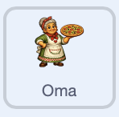
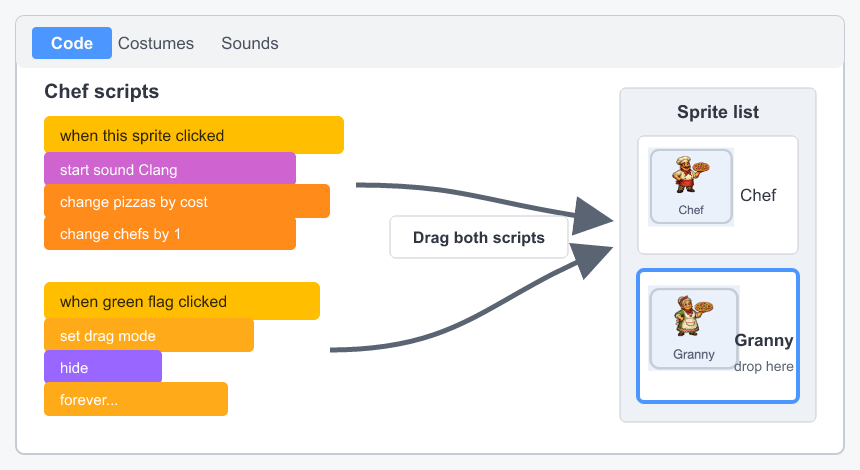

## Voeg een tweede helper toe

Voeg een tweede, krachtigere helper toe die vijf pizza's per seconde maakt in plaats van één.

> [!TASK]
>
> Voeg nog een helper sprite toe. Het demo-project maakt gebruik van een oma.
>
> 
>
> Gebruik je eigen helper, of sla [de oma-sprite](images/granny-sprite.png) op en importeer deze met **Upload sprite**.

> [!TASK]
>
> Gebruik het vakje **Grootte** onder het Speelveld om de tweede helper te vergroten of verkleinen en sleep hem vervolgens naar een open positie. In het demoproject is de oma 30% van de normale grootte en bevindt ze zich rechts onder de chef-kok.

> [!TASK]
>
> Kopieer de twee scripts van je eerste helper naar de nieuwe sprite: sleep elk script vanuit het codegebied naar de nieuwe sprite in de spritelijst.
>
> > [!NOPRINT]
> >
> > 

> [!TASK]
>
> Maak een variabele genaamd `oma's`{:class="block3variables"} voor hoeveel tweede helpers de speler heeft aangenomen.

> [!TASK]
>
> Maak een variabele genaamd `oma prijs`{:class="block3variables"} voor hoeveel pizza's de volgende kost.

> [!TASK]
>
> Voeg het `Collect`{:class="block3sound"} geluid toe aan de tweede helper sprite.

> [!TASK]
>
> Klik op het `Speelveld`{:class="block3looks"} en voeg beginwaarden voor de nieuwe variabelen toe. De tweede helper begint op `100` pizza's omdat zij vijf keer sneller werkt.
>
> 
>
> ```blocks3
> when green flag clicked
> set [pizzas v] to (0)
> set [pizzas per click v] to (1)
> set [chefs v] to (0)
> set [chef price v] to (50)
> +set [grannies v] to (0)
> +set [granny price v] to (100)
> update pizzas per second :: custom
> forever
> wait (1) seconds
> change [pizzas v] by (pizzas per second)
> end
> ```

Klik op de groene vlag. De nieuwe uitlezingen zouden `oma's 0` en `oma prijs 100` moeten weergeven.

> [!TASK]
>
> Werk bij de tweede helper het gekopieerde koopscript bij, zodat het het bijbehorende geluid, aantal en de prijs gebruikt.
>
> Het `zend signaal`{:class="block3events"} blok blijft aan het einde staan, omdat de aanschaf van een van beide soorten helpers de pizza-per-seconde-snelheid verandert.
>
> <p align="center"></p>
>
> ```blocks3
> when this sprite clicked
> start sound (Collect v)
> change [pizzas v] by ((0) - (granny price))
> change [grannies v] by (1)
> set [granny price v] to (round ((granny price) * (1.15)))
> broadcast (update v)
> ```

> [!TASK]
>
> Werk het gekopieerde groene vlagscript bij, zodat de tweede helper alleen verschijnt wanneer de prijs ervan betaalbaar is.
>
> <p align="center"></p>
>
> ```blocks3
> when green flag clicked
> set drag mode [not draggable v]
> hide
> forever
> if <(pizzas) > ((granny price) - (1))> then
> show
> else
> hide
> end
> end
> ```

Klik op de groene vlag en bouw je score op. De eerste helper moet verschijnen bij 50 pizza's en de tweede helper bij 100 pizza's.

> [!TASK]
>
> Werk op het `Speelveld`{:class="block3looks"} de definitie van `bijwerken pizza's per seconde`{:class="block3custom"} bij.
>
> Het aantal chef-koks is ook hun bijdrage, want ieder maakt één pizza per seconde. Elke oma maakt er vijf tegelijk, dus vermenigvuldig alleen `oma's`{:class="block3variables"} met `5`.
>
> 
>
> ```blocks3
> define update pizzas per second
> set [pizzas per second v] to ((chefs) + ((grannies) * (5)))
> ```

> [!TIP]
>
> Het afwegen van kosten en beloningen zodat elke upgrade de moeite waard aanvoelt, wordt **spelbalancering** genoemd.

Koop een eerste helper en een oma. Het aantal pizza's per seconde moet 6 worden: één van de eerste helper en vijf van de oma. Stop met klikken en controleer of de score elke seconde met zes stijgt.

Je hebt nu een complete, eindeloze clicker: klikken, apparatuur en herhaalbare helpers die allemaal samenwerken.

> [!TIP]
>
> Klikken, geld verdienen, upgrades kopen en vervolgens sneller geld verdienen vormen de **kern van het spel**.
