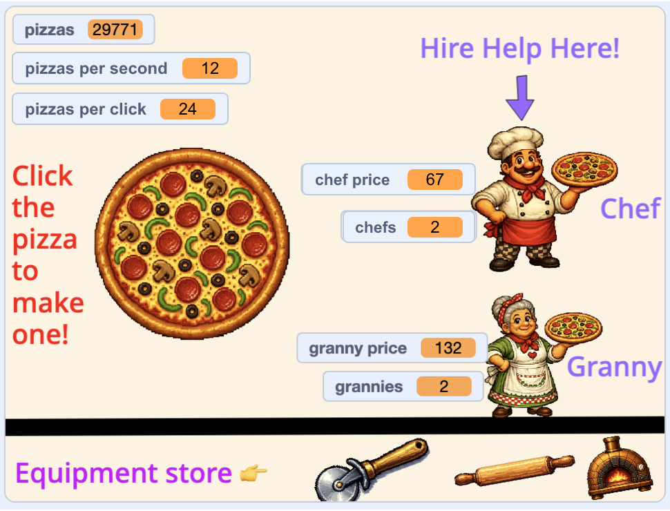

## Een achtergrond toevoegen

Het spel werkt momenteel wel, maar het is nogal saai. Maak er een mooie winkel van en organiseer de uitlezingen zodat de speler weet wat alles betekent.

> [!TASK]
>
> Teken een nieuwe achtergrond. Beweeg de muis over **Kies een achtergrond** (rechtsonder) en klik op **Tekenen** om een lege achtergrond te maken.

> [!TASK]
>
> Gebruik het **Tekst**-gereedschap in de teken editor om labels en instructies toe te voegen. De pizzeria gebruikt de opties "Klik op de pizza om er een te maken!", "Huur hier personeel in!" en "Apparatuurwinkel". Gebruik je eigen woorden en kleuren.

> [!TASK]
>
> Sleep je sprites naar de gewenste plek op het speelveld. In de pizzeria staat de pizza in het midden, de chef-kok en oma aan de rechterkant en de apparatuur onderaan.

> [!TASK]
>
> Sleep elke variabele-uitlezing naar de gewenste positie. De pizzeria plaatst `pizza's`{:class="block3variables"}, `pizza's per seconde`{:class="block3variables"} en `pizzas per klik`{:class="block3variables"} linksboven, zet `chef-kok prijs`{:class="block3variables"} en `chef-koks`{:class="block3variables"} bij de chef-kok, en `oma prijs`{:class="block3variables"} en `oma's`{:class="block3variables"} bij de oma.

> [!TIP]
>
> De score, prijzen en andere informatie die bovenaan het scherm van een spel worden weergegeven, worden vaak de **HUD** genoemd, een afkorting van **heads-up display**.

Klik op de groene vlag en vergelijk je layout met het voorbeeld. Controleer of alle sprites en variabelen zichtbaar zijn, of niets de instructies bedekt en of de helper sprites klein genoeg zijn om aan de rechterkant te passen. Je spel kan eruitzien zoals jij wilt.

