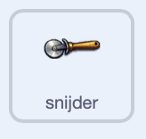

## Breng de apparatuur tot leven

Zorg dat je apparatuur beweegt, zodat de winkel levendig aanvoelt.

> [!TASK]
>
> Voeg dit script toe aan je eerste apparaat. Het richt de sprite in de richting van `90` om horizontaal te beginnen en laat hem vervolgens de hele tijd heen en weer bewegen.
>
> <p align="center"></p>
>
> ```blocks3
> when green flag clicked
> point in direction (90)
> forever
> turn right (10) degrees
> wait (0.2) seconds
> turn left (10) degrees
> wait (0.2) seconds
> turn left (10) degrees
> wait (0.2) seconds
> turn right (10) degrees
> wait (0.2) seconds
> end
> ```

> [!TASK]
>
> Voeg hetzelfde script toe aan je andere apparatuur sprites door het naar elke sprite in de spritelijst te slepen.

Klik op de groene vlag. Elk apparaat-sprite moet zachtjes heen en weer wiebelen en na elke beweging terugkeren naar de beginrichting.
