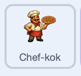

## Animeer de autoclickers

Geef je helpers een kleine pulsering, zodat het lijkt alsof hard aan het werk zijn.

> [!TASK]
>
> Voeg dit script toe aan je eerste helper. Het laat de sprite een beetje groeien en krimpen, steeds opnieuw.
>
> <p align="center"></p>
>
> ```blocks3
> when green flag clicked
> forever
> repeat (5)
> change size by (2)
> wait (0.05) seconds
> end
> repeat (5)
> change size by (-2)
> wait (0.05) seconds
> end
> end
> ```

> [!TASK]
>
> Voeg hetzelfde script toe aan je andere helper door het naar die helper te slepen in de sprite-lijst.

Klik op de groene vlag. Elke helper moet in totaal met 10 groeien, met 10 krimpen en terugkeren naar zijn oorspronkelijke grootte voordat de volgende pulsering wordt gegeven. Laat het spel draaien en controleer of de helpers blijven pulseren terwijl de score elke seconde blijft stijgen.

> [!TIP]
>
> Kleine animaties die een spel levendiger maken zonder de regels te veranderen, maken deel uit van **spelgevoel**, ook wel **juice** genoemd.

> [!SAVE]
